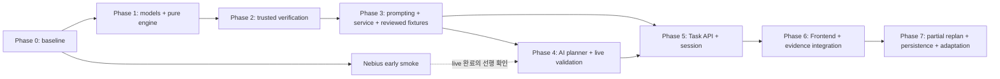

# ContextCue Backend Implementation Plan

> **Status:** 실행 순서와 진행 상태를 관리하는 Backend 작업 문서 (2026-10-22)
> **Current phase:** Phase 4 완료 + F1 production adapter 연결 및 후속 E4 실측 완료 (2026-10-22). 60 시도/실제 Nebius 36회, 정상 수용 22/40·보류 필요 차단 20/20; E4 전체는 개선 필요
> **Next task:** F3의 target/effect 품질, F2 역할/참조, F4 모델 보류 사유 및 요청 문법 coverage 검토. Phase 5 API/세션·공개 API/Frontend 연결은 미구현 유지
> **Parallel task:** Nebius Early Smoke Track — `passed` (2026-10-22), 공식 public endpoint와 설정된 NVIDIA 모델에서 최소 JSON 실호출 성공

이 문서는 새로운 개발 세션에서도 ContextCue Backend 작업을 안전한 순서로 이어가기 위한 실행 계획이다. 제품 범위는 `docs/PROJECT_PLAN.md`, 모듈과 데이터 경계는 `docs/SYSTEM_ARCHITECTURE.md`, 자동문 행동 기준은 `docs/scenarios/automatic-door.md`를 우선한다. 실제 구현 여부는 항상 코드와 테스트를 다시 확인한다.

## 1. 새 작업 세션에서 먼저 할 일

1. 루트 `AGENTS.md`, `backend/AGENTS.md`, `README.md`, `docs/TEAM_WORKFLOW.md`를 읽는다.
2. 이 문서와 현재 작업할 Phase에 연결된 `/docs` 문서를 읽는다.
3. `git status`와 `git branch --show-current`를 확인한다. 변경 사항을 버리거나 임의로 브랜치를 바꾸지 않는다.
4. 아래 **현재 구현 상태**와 실제 파일·테스트가 일치하는지 확인한다.
5. 완료되지 않은 가장 앞 Phase의 첫 체크박스부터 한 단위만 구현한다.
6. Backend 변경 후 `uv run pytest`와 `uv run ruff check .`를 `backend/`에서 실행한다.
7. 완료한 항목만 체크하고, 결과·제약·다음 작업을 이 문서에 갱신한다. 테스트를 실행하지 않았다면 완료로 표시하지 않는다.

현재 문서 작성 시점의 브랜치는 `docs/generic-task-engine-architecture`다. `main`의 `f43171a`를 병합한 `e78a752`가 로컬에 있으며, 문서 작성 시작 시 원격 기능 브랜치보다 2커밋 앞서 있었다. 이 정보는 스냅샷이므로 다음 세션에서는 Git 상태를 다시 확인해야 한다.

## 2. 현재 구현 상태

### 완료되어 있는 기반

- [x] FastAPI `GET /api/health`와 `POST /api/plan`
- [x] `PlanRequest`/`PlanResponse`, `Profile`, `SceneObject` Pydantic 계약
- [x] 정규화 bbox 범위와 scene object ID 중복 검사
- [x] `DEMO_RULES`와 선택적 `LIVE_NEBIUS` 경로 구분
- [x] 모델이 선택한 object ID의 grounding 및 label/대상 모호성 검사
- [x] 우유 가져오기에서 `can_grasp` 검사
- [x] 자동문 단일 단서에서 `can_press_button`과 `can_extend_arm` 검사 (`f43171a`)
- [x] live provider 실패를 demo 결과로 숨기지 않고 HTTP 502로 반환
- [x] Frontend의 별도 가방 챙기기 로컬 상태 머신과 도움 수준 0–4
- [x] 현재 Backend 회귀 기준: 2026-10-21 문서 정비 후 `uv run pytest` 46개 통과, `uv run ruff check .` 통과
- [x] Phase 1.1 내부 도메인 모델과 구조·참조 검증: 기존 46개 + 신규 56개 = 102개 테스트 및 Ruff 통과 (2026-10-21)

### Phase 1.1에서 추가된 내부 모델

- [x] 범용 `TaskPlan`, `TaskStep`, `TaskState`, `StepState`, `TaskEvent`, `Evidence` 데이터 모델
- [x] 의미적 `TargetRef`와 관찰 연결용 `TargetBinding`의 데이터 분리

위 모델은 기존 API에 연결되지 않았다. `TargetBinding`/`Evidence`의 형식 검증은 실제 관찰 진위·출처·freshness나 행동 완료를 입증하지 않는다.

### Phase 1.2에서 추가된 합성 계획 데이터

- [x] 자동문·가방 챙기기 JSON fixture를 같은 `TaskPlan`으로 검증하고 단계 순서·완료 목표 및 관찰/정책 필드 부재 확인
- [x] Phase 1.2 검증 기준: 기존 102개 + 신규 4개 = 106개 테스트 및 Ruff 통과 (2026-10-21)

두 fixture는 테스트용 의미적 계획이며 production template이나 실행·완료 검증 결과가 아니다. 시나리오별 Python 실행 파일은 추가하지 않았다.

### Phase 1.3에서 추가된 순수 제어 전이

- [x] 과제 독립 초기 상태 생성과 pause/resume/stop/refusal/more-help/help/manual-advance 처리
- [x] 입력 상태 보존, 단계와 도움 수준 분리, 무응답 시 상태 유지 및 잘못된 전이의 명시적 거부
- [x] Phase 1.3 검증 기준: 기존 106개 + 신규 74개 = 180개 테스트 및 Ruff 통과 (2026-10-21)

Phase 1.3은 제어 전이만 구현했다. 단계의 `active` 표시는 물리 행동 허가나 실제 완료를 뜻하지 않는다. binding/Evidence 처리와 완료 전이는 아래 Phase 1.4에서 추가했다.

### Phase 1.4에서 추가된 내부 Evidence와 완료 전이

- [x] 내부 `target_bound` 입력으로만 binding 갱신, Evidence의 append-only 기록 및 단계별 누적 이력 전달
- [x] 주입형 `CompletionEvaluator`와 근거 ID를 가진 `CompletionEvaluation`, 판정 결과 재검증과 satisfied/pending/conflicting 전이
- [x] 과제명·행동별 분기 없이 두 fixture를 같은 엔진/evaluator로 완료하고 단계 진입 시 도움 초기화
- [x] Phase 1.4 검증 기준: 기존 180개 + 신규 87개 = 267개 테스트 및 Ruff 통과 (2026-10-21)

Generic Task Engine의 Phase 1 구현은 완료했다. Phase 1의 camera/caregiver 입력과 test evaluator는 상위 계층에서 검증됐다고 가정한 합성 데이터다. 정책과 검증 경계는 아래 Phase 2에서 추가했으며 실제 관찰의 진위·출처나 신체 수행 가능성을 실환경에서 입증한 것은 아니다.

### Phase 2에서 추가된 trusted 정책과 입력 검증 경계

- [x] 다섯 generic action의 불변 정책 registry, capability/binding/context/completion 조건 정의
- [x] Plan 구조 → 관찰 binding → capability/hard constraint → 필요한 맥락 확인 순서의 결정론적 검증
- [x] 현재 observation revision, source principal, task/plan scope와 정확한 claim provenance를 검사한 내부 이벤트 승격
- [x] 기존 Engine의 evaluator 주입 인터페이스에 연결하는 trusted completion evaluator와 Profile adapter
- [x] Phase 2 검증 기준: 기존 267개 + 신규 73개 = 340개 테스트 및 Ruff 통과 (2026-10-21)

`VerificationContext`는 backend가 제공하는 신뢰 컨텍스트이며 client/AI 입력에서 역직렬화하면 안 된다. 인증된 camera/caregiver adapter 및 실제 물리 맥락 근거 수집은 아직 없고, 테스트는 합성 principal·receipt·관찰·능력·실행 가능성 fact를 사용했다. Phase 2 완료는 이 입력 계약과 안전한 거부 경계의 검증이다.

### Phase 3에서 추가된 순수 Prompting Policy와 Task Service

- [x] 도움 수준·guidance 선호를 반영해 cue 하나만 선택하고, visual cue에는 검증된 object ID/revision만 전달
- [x] 검증 → Engine → Prompting 순서를 조정하고 단계 진입·active context 변경·resume 후 재검증
- [x] cue 발행, Evidence 수용, 단계/Task 완료를 별도 audit event로 반환하며 무응답에서는 cue 재발행·도움 증가를 하지 않음
- [x] 두 합성 fixture의 동일 Service 경로 검증 및 자동문 production template 승격 보류 결정
- [x] Phase 3 검증 기준: 기존 340개 + 신규 56개 = 396개 테스트 및 Ruff 통과 (2026-10-21)

Service는 호출자가 넘긴 plan/state/backend 컨텍스트만 사용하는 내부 순수 함수이며 세션 저장·API·AI·TTS 재생·렌더러를 추가하지 않았다. Template은 로드하거나 사용하지 않았고, 실제 source adapter·물리 실행 가능성은 여전히 미검증이다.

### Phase 4에서 추가된 구조화된 계획 제안과 실행 전 검증

- [x] untrusted transcript를 별도 user 데이터로 직렬화하고, 의미적 `TaskPlan`만 파싱·검증하는 비동기 provider 경계
- [x] 잘못된 JSON·unknown action/outcome·object ID/bbox·Evidence·완료 정책 필드 거부 및 provider 오류의 비민감 reason code 처리
- [x] 명시적으로 선택한 backend reviewed registry와 AI 생성의 source/mode 구분, template artifact version 기록 및 자동 fallback 금지
- [x] Service/Engine 호출 전 Phase 2 gate 재검증 및 두 합성 fixture의 동일 생성·시작 경로 확인
- [x] Phase 4 검증 기준: 기존 396개 + 신규 mock 101개 = 497개 테스트 및 Ruff 통과 (2026-10-21)

초기 구현(2026-10-21)은 키 없이 mock 검증만 완료했다. 이후 live 검증에서 추론 토큰 소진·30초 timeout을 재현하고 현재 Lightning 모델의 추론 제어, 정책 기반 provider schema, 60초 전체 deadline을 적용했다. 최종 **512 passed**, Ruff 통과 및 자동문·가방 각 2회 **LIVE_NEBIUS TaskPlan 4/4 통과**를 확인했다. 거부 입력은 계획을 실행하지 않았다. production template 승격, 공개 API·세션 저장·실제 관찰 adapter는 아직 추가하지 않았다. 상세 진단·중간 실패·최종 결과는 Phase 4 기록에 남긴다.

### 아직 구현되지 않은 목표

- [ ] 실제 source adapter를 연결한 행동 완료 Evidence 검증 (결정론적 정책/승격 경계는 구현됐으나 실제 관찰은 미검증)
- [ ] production Template 검토·승격 및 별도 평가 세트의 계획 적절성/holdout 검증
- [x] Nebius Early Smoke와 실제 모델 접근/최소 JSON 검증 (2026-10-22, TaskPlan 최종 생성 검증도 통과)
- [ ] 신규 Task lifecycle API와 세션 보관
- [ ] Frontend Task Engine 연결
- [ ] 실제 카메라/검출기, ASR, 음성 출력
- [ ] 부분 재계획, 장기 기억, Prompt Fading

### 현재 코드의 중요한 한계

- `app/planner.py`는 `retrieve_object`, `open_door`, `unknown`만 처리하는 단일 단서 planner다.
- 현재 `/api/plan`은 Task Plan이나 행동 결과를 반환하지 않는다.
- 현재 자동문 응답은 버튼 위치 찾기와 누르기 능력을 하나의 보수적 검사로 묶는다. 새 Task Engine에서는 `locate`와 `press`를 별도 단계로 모델링하되 레거시 API 동작을 무심코 변경하지 않는다.
- Frontend 가방 데모의 `next`와 `caregiver_confirm`은 다음 단계로 이동하지만 실제 Evidence를 저장하지 않는다. 화면의 `completed`는 관찰된 실제 완료가 아니다.
- 현재 장면은 `DEMO_SCENE` fixture이며 실제 카메라 인식이 아니다.
- 설정된 `nvidia/Nemotron-3_5-Lightning`에서 최소 JSON 및 두 합성 과제의 TaskPlan 생성·초기 Service 진입은 검증했다. 최종 TaskPlan 지연은 약 6.0–32.3초이며, 60초 deadline 안에서 확인한 소규모 구현 검증이다. 기본 후보 모델·다른 계정/endpoint·일반 상황의 계획 적절성·실제 행동 성공을 입증하지 않는다.

## 3. 확정된 설계 결정

### 3.1 패키지와 의존 방향

- 새 Backend 기능은 하나의 `app/tasking/` 패키지에 둔다.
- `models.py`는 다른 `tasking` 모듈을 import하지 않는다.
- `engine.py`는 순수 상태 전이만 수행하며 FastAPI, AI provider, 과제명, 카메라를 알지 못한다.
- `service.py`가 planning → verification → engine → prompting 순서를 조정한다.
- Engine에는 `open_door`, `packing_bag` 같은 과제명별 분기를 넣지 않는다.
- 새 과제가 기존 action vocabulary를 조합하면 Engine 변경 없이 TaskPlan 데이터만 추가한다.
- 새로운 행동 의미가 필요할 때는 Engine이 아니라 trusted Action Policy를 확장한다.

### 3.2 unresolved target

- `TargetRef`는 `target_key`, 의미적 `concept`, 제한된 qualifier만 갖는다. 관찰 object ID와 bbox를 넣지 않는다.
- `TargetBinding`은 검증된 `object_id`와 `observation_revision`을 별도로 기록한다.
- 현재 binding은 `TaskState.target_bindings`에 저장한다.
- 물체가 아직 관찰되지 않아도 `TargetRef`는 유효하다. 텍스트·음성으로 찾기를 안내할 수 있다.
- highlight/arrow 또는 `press`, `grasp`, `place_inside` 같은 물리 행동은 유효한 binding 전에는 실행하지 않는다.
- AI가 향후 object ID 후보를 제안하더라도 현재 observation에서 확인된 뒤에만 binding으로 승격한다. 좌표는 언제나 observation에서 조회한다.

### 3.3 trusted completion

- AI/Template TaskPlan은 의미적 `CompletionGoal`만 선언한다.
- Plan은 허용 Evidence source, confidence threshold, 완료 quorum을 정하지 못한다.
- trusted `ActionPolicyRegistry`가 action별 허용 outcome, 필수 capability, binding 요구와 완료 Evidence 규칙을 제공한다.
- `manual_progress`, `cue_issued`, `model_assessment`, 무응답은 물리 행동의 완료 증거가 아니다.
- AI Verification 결과는 contextual assessment이며 관찰 Evidence가 아니다.
- 알 수 없거나 action과 맞지 않는 completion goal은 실행하지 않고 확인/거부한다.
- 완료 evaluator는 단순 `bool`이 아니라 아래의 작은 결과를 반환한다.

```text
CompletionEvaluation
  status: satisfied | pending | conflicting
  considered_evidence_ids: 평가에 사용한 Evidence ID
  supporting_evidence_ids: 완료를 지지한 Evidence ID
  conflicting_evidence_ids: 완료와 충돌한 Evidence ID
  reason_code: insufficient_evidence, criterion_satisfied, contradictory_evidence 등의 안정적인 코드
```

- `satisfied`만 단계 완료를 허용한다.
- `pending`은 `awaiting_evidence`를 유지한다.
- `conflicting`은 완료하지 않고 `needs_confirmation`으로 전환한다.
- `satisfied`에는 하나 이상의 supporting Evidence가 필요하고 conflicting Evidence가 없어야 한다. `conflicting`에는 하나 이상의 conflicting Evidence가 필요하다. `pending`은 아직 결정적 근거가 없음을 `reason_code`로 설명한다.
- 결과가 참조한 모든 Evidence ID는 현재 `TaskState.evidence`에 존재해야 하며 supporting/conflicting ID는 considered ID의 부분집합이어야 한다.
- 초기에는 점수 집계, rule graph, 설명 객체를 추가하지 않는다. Evidence ID와 reason code로 판정 근거를 추적할 수 있으면 충분하다.

### 3.4 상태와 도움

- Task 진행 상태와 prompt 도움 수준은 독립된 상태 축이다.
- 도움 수준은 명시적 사용자/보호자 요청 또는 신뢰 가능한 difficulty event로만 증가한다. 단순 무응답으로 자동 증가하지 않는다.
- 새 단계 진입 시 그 단계의 초기 도움 수준으로 재설정한다.
- `manual_advance`는 첫 구현에서 단계를 완료하거나 이동시키지 않고 `needs_confirmation`으로 전환한다.
- 마지막 단계까지 trusted completion을 만족해야만 Task가 `completed`가 된다.

### 3.5 Verification 순서

1. Pydantic 구조와 참조 무결성 검사
2. 존재하는 object binding의 ID·observation revision·모호성 검사
3. trusted Action Policy의 명시적 금지·필수 capability·completion 규칙 검사
4. 앞 단계가 통과했고 추가 맥락 판단이 필요한 경우에만 선택적 AI Verification
5. AI 결과 재검증 후 allow/confirm/assist/stop 중 안전한 결과 적용

AI는 앞 단계의 hard rejection을 뒤집거나 새 object ID, bbox, 행동 성공을 생성할 수 없다. unresolved target 자체는 오류가 아니지만, binding이 필수인 행동에서는 `awaiting_target` 또는 `needs_confirmation`으로 처리한다.

### 3.6 Phase 1과 Phase 2의 신뢰 경계

- Phase 1은 모델 형식과 상태 전이를 검증한다. 이 단계의 `TargetBinding`, `target_bound` 이벤트와 `Evidence`는 **상위 계층에서 검증되었다고 가정한 테스트 입력**이다.
- Phase 1에서 `source="camera_observation"`을 파싱하거나 test evaluator가 Evidence를 승인해도, 실제 카메라 관찰의 진위·출처·freshness를 입증한 것이 아니다.
- Phase 2가 외부 candidate binding/Evidence를 observation snapshot, revision, source 요구사항과 대조해 Engine에 전달 가능한 내부 입력으로 승격하는 신뢰 경계를 구현한다.
- 외부 입력을 신뢰할지 결정하는 정책과 Engine 진입 허용 책임은 Phase 2가 계속 소유한다. Phase 6의 카메라·보호자 입력 adapter는 검증 가능한 provenance를 제공하고 source별 end-to-end 검사를 추가할 뿐, 이 신뢰 결정을 우회하거나 대체하지 않는다.

## 4. 목표 디렉터리 구조

아래 파일을 한 번에 만들지 않는다. 각 Phase에서 필요한 파일만 추가한다.

```text
backend/
├── IMPLEMENTATION_PLAN.md
├── app/
│   ├── main.py                     # 기존 API 유지
│   ├── schemas.py                  # 기존 /api/plan 공개 계약
│   ├── planner.py                  # 기존 단일 단서 facade
│   ├── tasking/
│   │   ├── __init__.py
│   │   ├── models.py               # Phase 1
│   │   ├── engine.py               # Phase 1
│   │   ├── verification.py         # Phase 2
│   │   ├── prompting.py            # Phase 3
│   │   ├── service.py              # Phase 3
│   │   └── planning.py             # Phase 4
│   └── templates/                  # Phase 3 이후, 검토된 데이터만
│       └── automatic_door.v1.json
├── scripts/
│   └── nebius_smoke.py             # Early Smoke Track, opt-in live 확인
└── tests/
    ├── test_api.py
    ├── test_planner.py
    ├── test_task_models.py
    ├── test_task_engine.py
    ├── test_task_verification.py
    ├── test_task_prompting.py
    ├── test_task_service.py
    └── fixtures/
        └── plans/
            ├── automatic_door.json
            └── packing_bag.json
```

실제 카메라 등 복수 perception source가 생기기 전에는 `perception/` 패키지를 만들지 않는다. 새 route와 저장소 파일도 해당 Phase 전에는 추가하지 않는다.

## 5. Phase 의존 관계



Nebius early smoke는 Phase 1과 병행할 수 있다. 접근 실패나 계정 미준비는 Phase 1–3의 로컬 구현을 막지 않지만 `LIVE_NEBIUS` 성공이나 Phase 4의 live 완료를 주장할 수는 없다. AI가 만든 계획을 공개 Task API에서 사용하려면 Phase 2의 검증 경계도 먼저 완료되어야 한다.

## 6. Phase 0 — 기존 안전 기준선과 문서 정렬

**상태:** 완료

**목표:** 기존 `/api/plan`을 안전한 회귀 기준으로 보존하고 목표 구조와 현재 구현을 구분한다.

**완료 작업**

- [x] `/api/plan`의 객체 grounding, bbox, 중복 ID 검사 확인
- [x] `f43171a`의 자동문 `can_press_button` + `can_extend_arm` 검사와 테스트 반영
- [x] `DEMO_SCENE`, `DEMO_RULES`, `LIVE_NEBIUS` 용어 구분
- [x] 자동문 대표 시나리오와 가방 Frontend 데모의 역할 구분
- [x] Generic Task Engine 방향 합의
- [x] 단일 `tasking/` 패키지, unresolved target, trusted completion, verification 순서 합의
- [x] 상세 Backend 구현 계획 작성

**관련 파일**

- `app/main.py`
- `app/schemas.py`
- `app/planner.py`
- `tests/test_api.py`
- `tests/test_planner.py`
- `docs/PROJECT_PLAN.md`
- `docs/SYSTEM_ARCHITECTURE.md`

**완료 기준**

- 기존 Backend 회귀 테스트와 lint가 통과한다.
- 목표 기능을 구현 완료로 잘못 표시하지 않는다.
- 다음 작업이 Phase 1.1로 명시되어 있다.

## 6A. 병행 Track — Nebius Early Smoke

**상태:** `passed` (2026-10-22) — `LIVE_NEBIUS` 최소 JSON 실호출 성공, TaskPlan 성공과 구분

Phase 4 선행 점검에서 기존 endpoint/model 설정을 재사용하는 임시 실행으로 키 존재 여부를 확인했다. 결과는 `api_call_attempted=false`, endpoint host `api.tokenfactory.us-central1.nebius.com`, model ID `nvidia/nemotron-3-nano-omni`다. 계정 접근·JSON 응답·latency는 확인하지 못했으며, 사용자는 키 없이 mock 검증을 완료하고 live 미검증으로 기록하도록 요청했다. 별도 smoke entrypoint는 추가하지 않았다.

위 내용은 2026-10-21 초기 기록이다. 2026-10-22 Phase 4 재검증에서는 `scripts/verify_phase4.py`의 최소 smoke 1회가 endpoint host `api.tokenfactory.nebius.com`, model ID `nvidia/Nemotron-3_5-Lightning`에서 **passed**, latency **16,439.6 ms**, Pydantic schema 검증 **통과**했다. 합성 object ID 한 개만 선택했으며 실제 카메라나 행동 완료를 검증한 것은 아니다. 같은 실행의 TaskPlan 4회는 모두 timeout으로 실패했다.

**목표:** 전체 AI Task Planner를 만들기 전에 현재 계정의 모델 접근 권한, API 연결, 최소 JSON 출력 가능성을 가장 작은 live 호출로 확인한다.

**선행 조건**

- Phase 0 완료
- 유효한 `NEBIUS_API_KEY`를 ignored `backend/.env`에만 보관
- 합성 request만 사용

**예상 수정 대상**

- `scripts/verify_phase4.py` — Phase 4 재현 스크립트의 최소 smoke 사용 (`scripts/nebius_smoke.py`는 별도로 추가하지 않음)
- 필요 시 `.env.example` 설명만 보완
- Smoke 결과 기록은 이 문서 또는 비밀정보가 없는 별도 문서

**작업**

- [x] 별도 dependency 없이 기존 `AsyncOpenAI` 설정을 재사용하는 opt-in smoke entrypoint 추가
- [x] 합성 scene의 기존 object ID 하나만 선택하는 최소 JSON schema로 호출하고, provider의 JSON/structured-output 옵션과 Pydantic 검증을 통과하는지 확인
- [x] 자격 증명 누락, 인증/권한 오류, model unavailable, timeout, 빈 응답, JSON schema 오류, 성공을 구분 — 오류 분류는 mock, 실제 timeout과 smoke 성공은 live로 확인
- [x] 성공 시 실제 사용한 endpoint 구분, model ID, latency, schema 통과 여부만 기록
- [x] API key, authorization header, raw 민감 prompt/response를 출력하거나 커밋하지 않음
- [x] 실패 시 demo 결과로 fallback하지 않고 실패 유형을 그대로 보고

**테스트 및 완료 기준**

- [x] 실제 호출이 성공하면 `LIVE_NEBIUS` smoke로 명시하고 최소 JSON이 현재 schema로 검증된다.
- [x] 호출을 실행하지 않았거나 실패했다면 `not_run` 또는 `unavailable`로 기록하고 성공으로 체크하지 않는다.
- [x] smoke 성공은 Generic TaskPlan 생성, 안전성, 실제 카메라 또는 행동 완료를 입증하지 않는다.
- [x] smoke 결과와 무관하게 Phase 1 로컬 테스트 구현을 계속할 수 있다.

Phase 4에서는 이 결과를 출발점으로 TaskPlan 크기의 구조화 출력 안정성과 오류 처리를 다시 검증한다. Early smoke를 Phase 4 전체 완료로 간주하지 않는다.

## 7. Phase 1 — 최소 도메인 모델과 순수 Generic Task Engine

**상태:** 완료 — Phase 1.1–1.4 및 전체 완료 게이트 충족. 가정된 내부 입력과 합성 test evaluator 범위이며 production 검증은 미구현

**목표:** AI, API, DB 없이 범용 계획·상태·이벤트·증거 모델과 결정론적인 순수 상태 전이를 구현한다.

**선행 조건**

- Phase 0 완료
- 기존 `/api/plan` 계약을 변경하지 않기로 유지

### Phase 1.1 — 최소 모델

**상태:** 완료 (2026-10-21) — 아래 모델 형식과 참조 검증에 한정

**수정 대상**

- `app/tasking/__init__.py` 신규
- `app/tasking/models.py` 신규
- `tests/test_task_models.py` 신규

**작업**

- [x] `TargetRef`: 의미적 target만 표현하고 object ID/bbox 필드 금지
- [x] `TargetBinding`: `target_key`, `object_id`, `observation_revision`을 분리한 내부 데이터 형태 정의. Phase 1에서는 값이 상위 계층에서 검증되었다고 가정
- [x] `CompletionGoal`: outcome과 target key만 표현하고 Evidence source 정책 금지
- [x] `TaskStep`: step ID, action, target key, completion goal, 최대 도움 수준
- [x] `TaskPlan`: schema version, plan ID, goal, targets, 순서가 있는 steps
- [x] `Evidence`: 선언된 source, claim/outcome, target/object 참조, supports/contradicts/inconclusive. Phase 1에서는 source 문자열의 진위를 검증하지 않음
- [x] `TaskEvent`: pause/resume/stop/refusal/more-help/help/manual-advance/cue-issued/target-bound/evidence-received
- [x] `StepState`와 `TaskState`: 단계 상태, 현재 단계, 독립 help level, binding, evidence
- [x] Pydantic model은 mutable default를 공유하지 않고 알 수 없는 제어 필드를 거부

**테스트 및 완료 기준**

- [x] object ID가 없는 unresolved `TargetRef`가 유효하다.
- [x] `TargetRef`에 bbox/object ID를 직접 넣으면 거부한다.
- [x] 중복 target/step ID와 존재하지 않는 target key 참조를 거부한다.
- [x] Plan이 allowed Evidence sources나 confidence threshold를 지정할 수 없다.
- [x] 모델 round-trip과 기본값 독립성을 검증한다.
- [x] `TargetBinding`/`Evidence` 모델 검증이 실제 관찰 진위나 source 신뢰성을 입증하지 않는다는 테스트 설명을 남긴다.

**구현 선택과 인수인계**

- 변경 파일: `app/tasking/__init__.py`, `app/tasking/models.py`, `tests/test_task_models.py`, 이 계획서.
- 실제 검사: `backend/`에서 `uv run pytest` **102 passed** (기존 API/planner 46개 + 모델 56개), `uv run ruff check .` **All checks passed!**.
- 기존 FastAPI TestClient의 Starlette deprecation warning 1개와 uv의 `SSL_CERT_DIR` 인증서 경고가 있었으나 두 명령 모두 exit code 0이었다. 이 작업에서 dependency/환경 설정은 변경하지 않았다.
- `schema_version="1.0"`, `target_keys` 목록과 `outcome`은 설계 예시를 따른다. qualifier는 현재 `color`/`relative_position` 텍스트만 허용한다.
- 상태는 `current_step_id`와 단계별 `StepState.help_level`을 별도 보관한다. 초기 도움 수준은 0, 단계별 최대 기본값은 4이며 이 내부 기본값은 Frontend/자동문 도움 척도를 통합한다는 뜻이 아니다.
- 이벤트 이름은 설계안의 snake_case(`more_help`, `help_requested`, `manual_advance` 등)를 사용한다. 이벤트별 payload 형식만 검증하고 상태 전이를 실행하지 않는다.
- `observation_revision`은 비어 있지 않은 문자열 참조다. action/outcome 지원 여부, capability, target cardinality, binding freshness/source provenance 및 완료 판정은 구현하지 않았으며 후속 Phase의 책임이다.
- 증거 구분: 모든 신규 입력은 합성 데이터다. 기존 `DEMO_RULES` 회귀 테스트만 실행했으며 실제 `DEMO_SCENE` 감지나 `LIVE_NEBIUS` 호출은 실행하지 않았다. Early Smoke는 `not_run`이다.
- 범위 확인: `app/main.py`, `app/schemas.py`, `app/planner.py`, Frontend와 dependencies는 변경하지 않았다. Engine, CompletionEvaluation, 과제 fixture, trusted verification, 신규 API는 추가하지 않았다. commit/push하지 않았다.
- 바로 다음 작업: **Phase 1.2만** 진행하여 두 JSON fixture를 같은 `TaskPlan`으로 검증한다. Phase 1 전체 완료로 표시하지 않는다.

### Phase 1.2 — 두 과제 fixture

**상태:** 완료 (2026-10-21) — 합성 계획 데이터와 모델 검증에 한정

**수정 대상**

- `tests/fixtures/plans/automatic_door.json` 신규
- `tests/fixtures/plans/packing_bag.json` 신규
- `tests/test_task_models.py`

**작업**

- [x] 자동문을 `locate_button → press_button → confirm_open → pass_through`로 표현
- [x] 가방 챙기기를 `locate_bag → locate_bottle → place_bottle → verify_items`로 표현
- [x] 두 fixture 모두 특정 관찰 object ID 없이 semantic target으로 시작
- [x] `complete` pseudo-step을 만들지 않고 마지막 행동의 trusted completion으로 Task 종료

마지막 항목은 별도 완료 단계를 두지 않는 **계획 데이터 구조**를 충족했다는 뜻이다. 실제 Task 종료 전이와 trusted completion 실행은 각각 Phase 1.4와 Phase 2에서 구현·검증한다.

**테스트 및 완료 기준**

- [x] 두 JSON이 동일한 `TaskPlan` 모델로 검증된다.
- [x] fixture 안에 bbox나 관찰 object ID가 없다.
- [x] 시나리오별 Python 실행 파일이 없다.

**구현 선택과 인수인계**

- 변경 파일: `tests/fixtures/plans/automatic_door.json`, `tests/fixtures/plans/packing_bag.json`, `tests/test_task_models.py`, 이 계획서. 이전 Phase 1.1의 미커밋 변경은 보존했다.
- 실제 검사: `backend/`에서 `uv run pytest` **106 passed** (기존 102개 + fixture 검증 4개), `uv run ruff check .` **All checks passed!**. 기존 Starlette deprecation warning 1개와 uv의 `SSL_CERT_DIR` 경고는 동일하며 두 명령 모두 exit code 0이었다. `git diff --check`도 통과했다.
- 두 fixture는 `locate`, `press`, `observe_state`, `traverse`, `place_inside`를 데이터로 조합한다. 자동문 마지막 목표는 `passed_through`, 가방 마지막 목표는 `items_inside`다. 가방의 `place_inside`는 `target_keys=["bottle", "bag"]`로 넣을 물체와 목적 용기를 순서대로 참조하고 `placed_inside`를 목표로 선언한다.
- 가방의 새 outcome 이름은 fixture의 의미적 목표이며 trusted Action Policy가 승인한 vocabulary는 아니다. action/outcome 지원·필수 능력·도달 가능성·출처·완료 정책은 후속 Phase에서 검증해야 한다. Frontend의 기존 5단계 가방 데모와 연결하지 않았다.
- 증거 구분: 합성 계획 데이터만 추가했다. 기존 `DEMO_RULES` 회귀 테스트를 실행했으며 `DEMO_SCENE` 관찰 수집이나 `LIVE_NEBIUS` 호출은 실행하지 않았다. Early Smoke는 `not_run`이다.
- 범위 확인: 이번 작업은 모델·Engine·trusted verification·API·Frontend·dependencies를 변경하거나 추가하지 않았다. commit/push하지 않았다.
- 바로 다음 작업: **Phase 1.3만** 진행하여 초기 상태 및 pause/resume/stop/refusal/help/manual-advance의 순수 제어 상태 전이를 구현한다. Phase 1 전체 완료 게이트는 미완료로 유지한다.

### Phase 1.3 — 제어 상태 전이

**상태:** 완료 (2026-10-21) — 순수 제어 전이에 한정

**수정 대상**

- `app/tasking/engine.py` 신규
- `tests/test_task_engine.py` 신규

**작업**

- [x] 초기 `TaskState` 생성
- [x] pause/resume, stop, refusal 처리
- [x] 명시적인 more-help/help 요청 처리
- [x] 단계와 help level을 독립적으로 관리
- [x] 무응답으로 상태가 변하지 않도록 보장
- [x] `manual_advance`는 이동하지 않고 `needs_confirmation`으로 전환
- [x] invalid transition은 상태를 손상시키지 않는 명확한 결과로 반환

**테스트 및 완료 기준**

- [x] pause 중 진행 이벤트가 차단되고 resume 후 재개된다.
- [x] stop/refusal 후 terminal 상태에서 진행하지 않는다.
- [x] more-help 이벤트에서만 help level이 증가하고 상한을 넘지 않는다.
- [x] 단계 번호 변경 없이 help level만 변할 수 있다.
- [x] 무응답을 나타내는 이벤트/호출 부재는 실패나 도움 증가가 아니다.

**구현 선택과 인수인계**

- 변경 파일: `app/tasking/engine.py`, `tests/test_task_engine.py`, 이 계획서. 이전 Phase 1.1–1.2의 미커밋 변경은 보존했다.
- 실제 검사: `backend/`에서 `uv sync --group dev` 성공, `uv run pytest` **180 passed** (기존 106개 + 제어 전이 74개), `uv run ruff check .` **All checks passed!**. 기존 Starlette deprecation warning 1개와 uv의 `SSL_CERT_DIR` 경고는 동일하며 검사 명령은 모두 exit code 0이었다.
- 인터페이스: `create_task_state(plan, task_id)`는 첫 단계만 `active`, 나머지는 `pending`, 단계별 도움은 0으로 생성한다. `apply_event(plan, state, event=None)`는 입력과 중첩 mutable 값을 공유하지 않는 새 상태 및 `TransitionResult(state, accepted, reason_code)`를 반환한다. 실패 시 상태 내용은 유지한다.
- `more_help`는 현재 단계의 도움만 최대 `max_help_level`까지 올린다. 상한에서 `help_limit_reached`로 상태를 유지한다. `help_requested`는 도움 수준 증가 없이 `needs_assistance`, `manual_advance`는 단계 이동 없이 `needs_confirmation`으로 전환한다.
- pause는 `active`에서만, resume은 정상 현재 단계를 가진 `paused`에서만 허용한다. 단계 내부 상태와 도움은 보존한다. 확인/보조 필요 상태를 pause/resume으로 해제하지 않으며 이 상태의 승인·해제 정책은 추가하지 않았다.
- stop/refusal/help 요청은 terminal이 아닌 상태에서 task 전체에 적용한다. 오래된 step hint, plan 불일치나 도움 상한 오류로 중단·거부·보조 요청을 차단하지 않는다. 그 외 제어는 plan/단계 일치와 도움 범위를 검사한다. `stopped`/`completed`는 모든 실제 이벤트를 거부한다.
- `event=None`은 무응답/이벤트 부재를 뜻하는 no-op이며 실패나 도움 증가를 만들지 않는다. `cue_issued`, `target_bound`, `evidence_received`는 이번 Phase에서 `unsupported_event`로 거부한다. binding/Evidence 기록·완료 evaluator·다음 단계 이동은 구현하지 않았다.
- 두 합성 fixture에 같은 엔진 테스트를 적용했다. 테스트의 후속 단계/`completed` 상태와 기존 binding/Evidence는 상태 보존 검사용 가정된 입력일 뿐, 엔진이 실제 행동을 완료하거나 source 신뢰성을 검증했다는 증거가 아니다.
- 증거 구분: 합성 제어 상태 테스트와 기존 `DEMO_RULES` 회귀 테스트만 실행했다. `DEMO_SCENE` 관찰 수집과 `LIVE_NEBIUS` 호출은 실행하지 않았다. Early Smoke는 `not_run`이다.
- 범위 확인: 모델·fixture·기존 API·Frontend·dependencies는 이번 작업에서 변경하지 않았다. Phase 1.4, trusted verification, AI, 신규 API, DB를 추가하지 않았고 commit/push하지 않았다.
- 바로 다음 작업: **Phase 1.4만** 진행하여 가정된 binding/Evidence 기록과 `CompletionEvaluation`/주입형 evaluator 및 완료 전이를 구현한다. Phase 1 전체 완료 게이트는 미완료로 유지한다.

### Phase 1.4 — 가정된 binding/Evidence와 완료 전이

**상태:** 완료 (2026-10-21) — 모델 형식·내부 가정 입력·순수 상태 전이에 한정

**수정 대상**

- `app/tasking/engine.py`
- `tests/test_task_engine.py`

**작업**

- [x] 상위 계층에서 검증되었다고 가정한 내부 `target_bound` 이벤트로만 `TaskState.target_bindings` 갱신
- [x] Evidence를 append-only 기록으로 상태에 추가
- [x] Engine이 action 의미를 하드코딩하지 않도록 CompletionEvaluator(step, evidence_history) -> CompletionEvaluation callable/protocol을 주입한다. evidence_history는 현재 단계에 관련된 누적 Evidence를 의미한다.
- [x] `CompletionEvaluation`은 `status`, considered/supporting/conflicting Evidence ID, `reason_code`만 갖는 작은 결과로 정의
- [x] 결과가 참조한 Evidence ID의 존재 여부, supporting/conflicting이 considered의 부분집합인지, status별 최소 근거 조건을 검증
- [x] `satisfied`에서만 단계 완료 및 다음 단계 이동
- [x] `pending`에서는 현재 단계와 `awaiting_evidence` 유지
- [x] `conflicting`에서는 완료하지 않고 `needs_confirmation`으로 전환
- [x] 다음 단계 진입 시 help level 초기화
- [x] 모든 단계가 trusted completion을 충족한 경우에만 Task 완료

**테스트 및 완료 기준**

- [x] unresolved target을 포함한 계획을 시작할 수 있다.
- [x] `cue_issued`, `manual_progress`, `model_assessment`, inconclusive Evidence가 완료시키지 않는다.
- [x] test evaluator의 `pending` 결과가 단계와 help level을 유지한다.
- [x] test evaluator의 `conflicting` 결과가 근거 Evidence ID를 보존하고 확인 상태로 전환한다.
- [x] test evaluator의 `satisfied` 결과만 단계를 완료한다.
- [x] 존재하지 않는 Evidence ID, 근거 목록의 잘못된 포함 관계, status와 맞지 않는 근거 조합을 거부한다.
- [x] camera/caregiver로 표시된 Evidence는 테스트에서 검증된 것으로 가정한 입력일 뿐이며 실제 source 신뢰성의 증거로 표현하지 않는다.
- [x] 자동문과 가방 fixture가 같은 Engine과 evaluator 인터페이스를 사용한다.
- [x] Engine에 task 이름별 분기가 없다.

**구현 선택과 인수인계**

- 변경 파일: `app/tasking/engine.py`, `tests/test_task_engine.py`, 이 계획서. 이전 Phase 1.1–1.3의 미커밋 변경은 보존했다.
- 실제 검사: `backend/`에서 `uv sync --group dev` 성공, `uv run pytest` **267 passed** (기존 180개 + 신규 87개), `uv run ruff check .` **All checks passed!**. 기존 Starlette deprecation warning 1개와 uv의 `SSL_CERT_DIR` 경고만 남았으며 명령은 모두 exit code 0이었다. `git diff --check` 통과 및 기존 API/Frontend/dependency 파일의 diff 부재를 확인했다.
- `CompletionEvaluation`/`CompletionEvaluator`는 이번 Phase의 수정 대상인 `engine.py`에 정의했다. `apply_event(..., evaluator=...)`는 현재 단계의 누적 Evidence만 깊은 복사로 전달한다. `TransitionResult.evaluation`으로 considered/supporting/conflicting ID와 reason code를 반환하며, 상태는 원본 Evidence 이력을 보존한다.
- 내부 binding은 선언된 target key만 허용하고 값은 복사한다. 실제 object ID 존재·revision freshness는 검증하지 않는다. Evidence는 현재 단계/target 참조와 ID 중복을 검사한 뒤 append하며, 누락 evaluator에서는 `awaiting_evidence`를 유지한다.
- cue 발행은 완료 판정기를 호출하거나 성공 Evidence를 생성하지 않고 `awaiting_evidence`로만 전환한다. manual/cue/model/unknown source와 inconclusive claim은 완료 지지 근거로 승격할 수 없다. 이는 공통 허위 완료 방지 조건이며 action별 source 허용·confidence·provenance 정책 구현이 아니다.
- 평가 결과를 다시 Pydantic 검증하고, 근거 ID는 현재 단계 이력 안에 존재해야 한다. 지지/충돌 목록은 considered의 서로 겹치지 않는 부분집합이어야 하며, 각 근거의 supports/contradicts relation도 확인한다. `satisfied`는 지지 근거와 충돌 부재, `conflicting`은 충돌 근거를 요구하고 `pending`은 충돌 목록을 허용하지 않는다.
- `pending`은 단계/도움 수준을 유지하고, `conflicting`은 Evidence와 판정 근거를 보존하며 `needs_confirmation`으로 전환한다. 잘못된 판정이나 evaluator 예외도 받은 Evidence를 삭제하지 않고 확인 상태로 전환하며 `accepted=false`와 이유 코드를 반환한다. 다른 입력/제어 거부는 기존 상태를 보존한다.
- `satisfied`에서만 현재 단계를 완료하고 다음 단계 도움을 0으로 초기화한다. 이전 단계가 모두 완료되고 이후 단계가 대기 중인지 검사해 단계 건너뛰기를 거부하며, 마지막 단계 완료 시 `status=completed`, `current_step_id=None`으로 종료한다. 확인/보조 필요 상태의 해제 정책은 추가하지 않았다.
- 두 fixture가 동일한 엔진과 합성 test evaluator로 끝까지 전이했다. 이 결과는 source label의 진위, 실제 센서, 신체 수행 가능성이나 production 완료 정책을 입증하지 않는다. `DEMO_RULES` 회귀 테스트는 실행했으며 `DEMO_SCENE` 관찰 수집과 `LIVE_NEBIUS` 호출은 실행하지 않았다. Early Smoke는 `not_run`이다.
- 범위 확인: 기존 공개 API·모델·fixture·Frontend·dependencies는 이번 작업에서 변경하지 않았다. PlanPatch, AI, 신규 API, DB, production Verification Agent는 추가하지 않았고 commit/push하지 않았다.
- 바로 다음 작업: **Phase 2**에서 action vocabulary를 검토하고 trusted Action/Completion Policy 및 외부 candidate를 내부 입력으로 승격하는 검증 경계를 구현한다. 이번 작업에서는 Phase 2를 시작하지 않았다.

### Phase 1 전체 완료 게이트

- [x] `app/main.py`, `app/schemas.py`, `app/planner.py`, Frontend를 변경하지 않았다.
- [x] `PlanPatch`, AI, 신규 API, DB, production Verification Agent를 추가하지 않았다.
- [x] Phase 1 테스트가 실제 관찰의 진위·출처 또는 production completion policy를 검증한다고 주장하지 않는다.
- [x] `uv run pytest` 통과
- [x] `uv run ruff check .` 통과
- [x] 실제 테스트 수와 결과를 이 문서의 진행 상태에 기록

## 8. Phase 2 — Trusted Action/Completion Policy와 결정론적 Verification

**상태:** 완료 (2026-10-21) — 결정론적 정책·입력 계약·엔진 진입 경계에 한정, 실제 source adapter는 미연결

**목표:** AI 계획이나 Evidence가 명시적 안전 제약과 완료 규칙을 우회하지 못하게 한다.

이 Phase부터 외부의 candidate binding/Evidence를 그대로 Engine에 넣지 않고 검증된 내부 입력으로 승격한다. Phase 1의 모델과 test evaluator는 이 신뢰 경계를 대신하지 않는다.

**선행 조건**

- Phase 1 완료
- 최소 action vocabulary 검토

**수정 대상**

- `app/tasking/verification.py` 신규
- `app/tasking/models.py`
- `app/tasking/engine.py`의 evaluator 연결부
- `tests/test_task_verification.py` 신규
- 필요 시 `tests/test_task_engine.py`

**작업 순서**

- [x] `ActionPolicy`와 작은 registry 정의
- [x] 초기 generic action: `locate`, `press`, `observe_state`, `traverse`, `place_inside`
- [x] action별 target cardinality와 binding 요구 정의
- [x] action별 필수 capability와 false/unknown 처리 정의
- [x] action별 허용 `CompletionGoal`과 Evidence source 정의
- [x] Plan 구조/참조 검증 → binding 검증 → capability/hard constraint 검사 순서 구현
- [x] candidate `TargetBinding`의 object ID와 observation revision을 현재 observation snapshot에 대조
- [x] Evidence의 선언된 source에 필요한 provenance 필드와 trusted policy 허용 여부 검사
- [x] 검증을 통과한 binding/Evidence만 Engine용 내부 event로 변환
- [x] 기존 `Profile`을 내부 capability fact로 변환하는 adapter 구현
- [x] unsupported action/outcome/capability key를 안전하게 거부
- [x] AI Verification은 아직 구현하지 않고 `context_review_required` 같은 결과만 표현

**테스트 및 완료 기준**

- [x] `locate`는 unresolved target을 허용하고 누르기 능력을 요구하지 않는다.
- [x] `press`는 binding 및 `can_press_button`/`can_extend_arm`을 요구한다.
- [x] false capability는 assistance/stop, unknown은 confirmation으로 구분된다.
- [x] AI/Plan이 manual 또는 model Evidence를 완료 source로 만들 수 없다.
- [x] stale/unknown object binding이 거부되고 좌표는 생성되지 않는다.
- [x] source 이름만 camera/caregiver로 바꾼 Evidence가 자동으로 신뢰되지 않는다.
- [x] 누락되거나 일치하지 않는 observation revision/provenance가 거부 또는 confirmation으로 전환된다.
- [x] 구조 또는 hard constraint 실패 시 AI 호출 지점에 도달하지 않는다.
- [x] 기존 `/api/plan` 46개 회귀 테스트를 유지한다.

**확정한 초기 정책 vocabulary**

| action | 허용 outcome / target 수 | 행동 진입 시 binding | 필수 capability | 별도 물리 맥락 근거 |
|---|---|---|---|---|
| `locate` | `target_located` / 1 | 없어도 탐색 안내 가능 | 없음 | 불필요 |
| `press` | `pressed` / 1 | 필요 | `can_press_button`, `can_extend_arm` | 필요 |
| `observe_state` | `state_open` / 1, `items_inside` / 2 | 필요 | 없음 | 불필요 |
| `traverse` | `passed_through` / 1 | 필요 | `can_traverse` | 필요 |
| `place_inside` | `placed_inside` / 2 (물체, 용기 순서) | 필요 | `can_grasp`, `can_extend_arm`, `can_place_inside` | 필요 |

**구현 선택과 인수인계**

- 변경 파일: `app/tasking/models.py`, 신규 `app/tasking/verification.py`, 신규 `tests/test_task_verification.py`, 이 계획서. 기존 API·Frontend·fixture·dependencies와 Phase 1 Engine 코드는 변경하지 않았다.
- 실제 검사: `backend/`에서 `uv sync --group dev` 성공, `uv run pytest` **340 passed** (기존 267개 + Phase 2 73개), `uv run ruff check .` **All checks passed!**. 기존 API/planner 46개도 모두 통과했다. 기존 Starlette deprecation warning 1개와 uv의 `SSL_CERT_DIR` 경고만 남았고 명령은 모두 exit code 0이었다. `git diff --check` 및 범위 밖 파일 diff 부재도 확인했다.
- `ActionPolicy`는 frozen 모델, `ACTION_POLICIES`는 변경할 수 없는 mapping이다. Plan은 정책/source/confidence를 지정할 수 없다. 정책이 모르는 action/outcome/capability key와 잘못된 target 수·역할 순서는 안전하게 거부한다.
- `profile_to_capabilities`는 기존 공개 `Profile`의 세 bool/null fact만 복사한다. `can_place_inside`와 `can_traverse`는 내부 fact로 추가했으며 기본값은 미확인이다. grasp나 arm extension으로 넣기·통과 능력을 추정하지 않는다. capability false는 `assist`, unknown은 `confirm`, 잘못된 구조/정책은 `stop`으로 구분한다.
- `ObservationSnapshot`은 revision과 의미적 관찰 목록만 갖고 bbox를 만들지 않는다. binding의 ID/revision 및 concept/제한 qualifier를 대조하고, 일치 대상이 하나인지 확인한다. binding이 있으면 locate에서도 검증하며, 실제 완료 Evidence에는 locate도 관찰된 대상과 binding이 필요하다.
- `FeasibilityAssessment`는 backend가 제공하는 step/revision/ordered object ID 범위의 별도 물리 맥락 fact다. 필요한 능력이 true여도 이 fact가 없거나 unknown이면 `context_review_required`, false면 보조 필요로 반환한다. 실제 근거 수집·AI 맥락 추론은 구현하지 않았다.
- `Evidence`에 내부 optional `provenance_id`와 `confidence`를 추가했다. 형식 파싱만으로 신뢰를 얻지 않는다. 허용 source는 초기 다섯 action 모두 camera/caregiver이며 camera confidence 최소 0.9는 코드 정책이다. 이는 합성 테스트를 위한 초기 보수적 기준이며 실제 센서의 정확도나 통계적 보장을 검증한 값이 아니다.
- provenance는 후보가 제출하는 `verified=true`가 아니라 backend 컨텍스트의 `EvidenceReceipt`를 조회한다. source별 허용 principal, task/plan scope, receipt ID와 정확한 claim 전체(step/outcome/target/object/revision/relation/confidence/source)를 대조한다. source 재라벨링, claim 변조, 다른 task/plan의 기록 재사용과 누락 provenance를 거부한다. 실제 principal 인증/서명/receipt 생성 adapter는 Phase 6에서 연결해야 한다.
- `verify_step`는 구조 → 기존 binding → capability/hard constraint → 필요한 맥락 순서로 검사한다. `verify_event`는 active/current step 상태도 확인하고 통과한 binding/Evidence/cue 후보만 복사된 `TaskEvent`로 반환한다. 실패 시 `event=None`과 `allow/confirm/assist/stop` 판정을 제공하며, 상태/안내 orchestration은 Phase 3으로 남겼다. 내부 pause/stop/help 제어의 Phase 1 계약은 유지했다.
- `trusted_completion_evaluator(plan, bindings, context)`가 기존 Engine의 `evaluator=` 연결부를 사용한다. 컨텍스트를 깊은 복사로 고정하고 누적 Evidence를 정책/provenance와 재대조하며, 하나라도 검증되지 않은 기록이면 완료하지 않는다. 검증된 충돌은 `conflicting`, 지지 근거는 `satisfied`, 나머지는 `pending`으로 반환한다. 관찰/binding/컨텍스트가 바뀌면 gate와 evaluator를 다시 구성해야 한다.
- 외부 후보를 raw Engine 이벤트나 Phase 1 test evaluator로 직접 처리하면 이 경계를 우회한다. 이후 Service는 backend 전용 컨텍스트에서 이 gate와 trusted evaluator를 사용해야 한다. 이번 Phase는 공개 route나 client 컨텍스트 입력 경로를 추가하지 않았다.
- 두 합성 fixture가 같은 gate/정책/evaluator/Engine으로 끝까지 전이했다. 인증·센서·신체 실행 가능성은 합성 서버 fact로 가정했으며 실제 관찰 진위나 효능을 입증한 결과가 아니다. `DEMO_RULES` 회귀 테스트만 실행했고 `DEMO_SCENE` 관찰 수집과 `LIVE_NEBIUS` 호출은 실행하지 않았다. Early Smoke는 `not_run`이다.
- Phase 3의 Prompting/Service, AI Verification/Planner, 신규 API, DB, 실제 source adapter는 구현하지 않았으며 commit/push하지 않았다.
- 바로 다음 작업: **Phase 3**에서 이 검증 경계를 사용한 순수 Prompting Policy와 Service orchestration을 구현하고 두 fixture의 단계 진입·컨텍스트 변경 재검증을 테스트한다.

Phase 2가 외부 관찰의 진위·출처를 판정하는 정책과 Engine 진입 경계를 소유한다. 다만 실제 카메라 서명이나 보호자 인증처럼 source adapter가 있어야 제공할 수 있는 provenance는 Phase 6에서 연결하고 같은 Phase 2 정책으로 검증한다. 따라서 adapter 없이 끝낸 Phase 2는 실제 센서가 신뢰 가능함을 입증한 것이 아니라, 가짜·누락 provenance를 안전하게 거부할 계약을 강제한 상태다.

## 9. Phase 3 — Prompting Policy, Service orchestration, 검토된 fixture/template

**상태:** 완료 (2026-10-21) — 내부 순수 Prompting/Service 및 합성 검증에 한정. production template 승격은 보류

**목표:** 검증된 단계에 대해 한 번에 하나의 단서를 고르고, 외부 부작용 없이 전체 실행 순서를 조정한다.

**선행 조건**

- Phase 2 완료

**수정 대상**

- `app/tasking/prompting.py` 신규
- `app/tasking/service.py` 신규
- `app/templates/automatic_door.v1.json` 선택적 신규
- `tests/test_task_prompting.py` 신규
- `tests/test_task_service.py` 신규

**작업 순서**

- [x] help level과 사용자 guidance 선호를 입력으로 받는 순수 Prompting Policy 구현
- [x] unresolved target에는 좌표 기반 cue를 생성하지 않음
- [x] bound target cue도 object ID만 전달하고 bbox는 observation lookup에서 가져오게 함
- [x] cue 발행과 행동 완료를 별도 이벤트로 기록
- [x] Task Service가 verification → engine → prompting 순서를 조정
- [x] step 진입과 context 변경에서 재검증하도록 orchestration 정의
- [x] 자동문 fixture를 검토한 뒤 production template 승격 여부 결정
- [x] Template 사용 시 source/version을 명시 — 이번 Phase는 미사용으로 조건부 해당 없음. 향후 선택 경로를 추가할 때 필수 조건으로 유지

**테스트 및 완료 기준**

- [x] 한 번에 cue 하나만 반환한다.
- [x] 무응답만으로 help level을 올리지 않는다.
- [x] cue 발행이 step completion을 만들지 않는다.
- [x] invalid/unbound target에 highlight bbox를 반환하지 않는다.
- [x] Task Service 테스트는 AI, 네트워크, DB 없이 실행된다.

**구현 선택과 인수인계**

- 변경 파일: 신규 `app/tasking/prompting.py`, 신규 `app/tasking/service.py`, 신규 `tests/test_task_prompting.py`, 신규 `tests/test_task_service.py`, 이 계획서. 기존 Phase 2의 미커밋 변경은 보존했으며 이번 작업에서 수정하지 않았다.
- 실제 검사: `backend/`에서 `uv sync --group dev` 성공, `uv run pytest` **396 passed** (기존 340개 + Prompting 24개 + Service 32개), `uv run ruff check .` **All checks passed!**. 기존 API/planner 46개도 유지됐다. 기존 Starlette deprecation warning 1개와 uv의 `SSL_CERT_DIR` 경고만 남았으며 명령은 모두 exit code 0이었다. `git diff --check` 통과 및 기존 API/Frontend/dependency 파일의 diff 부재를 확인했다.
- `select_cue(plan, state, context, preferred_guidance)`는 독립 호출에서도 Phase 2 gate를 확인하고, 검증된 active 단계에서 `Cue | None` 하나만 반환한다. 입력과 도움 수준을 수정하지 않는다. unknown/stale/ambiguous target, blocked/unknown 물리 조건, pause/hold/terminal 상태에서는 행동 cue를 만들지 않는다.
- Backend 내부 도움 척도는 0=추가 cue 없음, 1=text/voice, 2=선호 시 highlight, 3=선호 시 arrow(없으면 허용된 낮은 도움), 4 이상=보조 요청 제안이다. 최대치는 단계의 `max_help_level`을 따른다. 기존 Frontend/자동문 문서의 척도를 변경하거나 통합한 것은 아니다. 도움 증가·보조자 인계는 여전히 명시적 제어 이벤트로 구분한다.
- unresolved locate에는 text/voice로 찾기만 안내한다. visual `Cue`에는 object ID와 observation revision을 함께 요구하고 bbox 필드 자체를 금지한다. 실제 renderer는 이 두 키로 일치하는 observation의 기존 bbox를 조회해야 하며, 텍스트로 좌표를 생성하면 안 된다. 이번 Phase는 renderer/perception adapter를 구현하지 않았다. `voice`는 텍스트와 출력 방식의 선택 결과이며 실제 음성 재생이 아니다.
- `start_task`는 제공된 구조적으로 유효한 계획으로 초기 상태를 만들고, `handle_event`는 매번 새 backend `VerificationContext`를 받아 외부 binding/Evidence/cue 후보를 검증한 후 Engine에 전달한다. Evidence에는 Phase 2 trusted evaluator를 새로 주입한다. AI/test evaluator를 선택하거나 실패를 demo 성공으로 바꾸는 경로는 없다.
- `ServiceResult`는 새 상태, 최대 하나의 cue, 이번 호출의 audit events 및 필요 시 completion evaluation을 반환한다. `cue_issued`는 발행 결정만 기록하며 Evidence/완료를 생성하지 않는다. `step_completed`/`task_completed`는 trusted `satisfied` 전이에서만 별도로 기록하고 지지 Evidence ID를 보존한다. 저장·전체 event history 누적은 호출자 책임이다.
- 새 단계 진입 직후 다시 검증한다. 이전 단계가 완료돼도 다음 단계의 binding/능력/물리 맥락이 불충분하면 완료 이력은 보존하고 새 단계는 확인/보조 필요 상태로 전환하며 cue를 반환하지 않는다. 이 경우 `accepted=false`는 최종 흐름 차단을 뜻하며, 반환 상태와 audit events에는 이미 수용한 이전 단계의 Evidence/완료가 남는다.
- active 상태의 `candidate=None` 호출은 현재 context만 재검증하고 cue를 재발행하거나 도움을 증가시키지 않는다. revision/능력/물리 fact가 바뀌면 즉시 확인·보조·중단 상태로 보낸다. pause에서는 진행하지 않고 resume 후 현재 context를 다시 확인한다. stop/refusal/help/manual-advance는 안내 없이 기존 안전 제어 의미를 유지한다.
- 확인/보조 필요 상태는 polling이나 resume으로 자동 해제하지 않는다. 명시적 승인·재검토 후 복귀 및 stale binding 정리의 별도 흐름은 추가하지 않았다. 입력 상태를 덮어쓰지 않으며 호출자는 반환된 상태를 이어 사용해야 한다. 실제 source 인증·관찰 freshness와 개인정보 보호는 backend adapter 경계를 통해 계속 보장해야 한다.
- 두 fixture가 동일 Service로 전체 전이했다. socket/DB 연결과 legacy live planner 호출을 차단한 테스트에서도 cue 및 Evidence 처리 경로가 실행됐다. 이 결과는 합성 principal·receipt·능력·물리 맥락 fact에 대한 검증이며 실제 카메라·신체 수행·접근성 효과를 입증한 것이 아니다. `DEMO_RULES` 회귀 테스트만 실행했고 `DEMO_SCENE` 관찰 수집, `LIVE_NEBIUS` 호출, 실제 TTS는 실행하지 않았다. Early Smoke는 `not_run`이다.
- 자동문 fixture는 기존 모델/정책 및 Service 흐름으로 검토했으나 production template으로 **승격 보류**했다. 실제 provenance adapter·물리 실행 근거 및 배포용 template 검토/versioning이 준비되지 않았기 때문이다. `app/templates/automatic_door.v1.json`을 만들지 않았고, Template을 로드/선택/사용하지 않았다. 현재 입력은 caller-provided `TaskPlan`이며 `schema_version`을 template artifact version으로 오인하지 않는다. 향후 Template을 사용하려면 source와 artifact version을 명시해야 한다.
- 기존 공개 API·모델·Engine·verification·fixture·Frontend·dependencies는 이번 Phase에서 변경하지 않았다. AI Planner/Verification, 신규 API, DB/세션 저장과 실제 source adapter는 추가하지 않았고 commit/push하지 않았다.
- 바로 다음 작업: **Phase 4**에서 Early Smoke 선행 조건(최소 한 번 시도 및 `passed`/`unavailable`/`not_run` 기록)을 확인하고, 구조화된 AI TaskPlan 제안과 Phase 2/3 검증 연결을 구현한다. 이번 작업에서는 Early Smoke나 Phase 4를 실행하지 않았다.

## 10. Phase 4 — 구조화된 AI Task Planner와 실제 모델 검증

**상태:** 완료 (2026-10-22) — 현재 계정/endpoint/Lightning 모델 및 두 합성 과제 범위에서 로컬/mock과 최종 live 완료 기준 충족

**목표:** 목표·프로필·관찰을 바탕으로 TaskPlan 제안을 생성하되 trusted verification 밖에서는 실행하지 않는다.

**선행 조건**

- Phase 2 완료
- Phase 3의 service 경계 확정
- Early Smoke Track을 적어도 한 번 시도하고 결과를 `passed`, `unavailable`, `not_run` 중 하나로 기록
- live 통합 완료를 주장하려면 Early Smoke가 실제 Nebius 계정과 대상 모델에서 `passed`

**수정 대상**

- `app/tasking/planning.py` 신규
- `app/planner.py`는 호환 facade로 필요한 만큼만 수정
- `tests/test_task_planning.py` 신규
- `tests/test_planner.py` 회귀 유지
- `.env.example`은 새 설정이 실제로 필요할 때만 수정

**작업 순서**

- [x] Planner 입력에서 transcript를 untrusted data로 취급
- [x] AI 출력 schema를 `TaskPlan` 제안으로 제한
- [x] semantic `TargetRef`와 unresolved target을 지원
- [x] AI가 bbox와 완료 Evidence를 생성하지 못하도록 출력 계약 제한
- [x] 잘못된 JSON, unknown action, 허위 candidate object ID 처리
- [x] 검증된 Template 선택과 AI 생성 source를 명시적으로 구분
- [x] live 호출 실패 시 `DEMO_RULES`로 몰래 fallback하지 않음
- [x] Early Smoke에서 확인한 endpoint/model을 사용해 TaskPlan 크기의 JSON 안정성, latency, 오류 처리 재검증 — 최초 0/4 timeout을 수정하고 최종 TaskPlan 4/4 및 거부 입력 실행 차단 확인

**테스트 및 완료 기준**

- [x] mock provider로 정상/잘못된 JSON/timeout/unknown ID 경로 검증
- [x] AI 제안은 Phase 2 verification을 통과하기 전 Engine에 들어가지 않는다.
- [x] AI가 completion policy를 완화할 수 없다.
- [x] 실제 live 검증을 했다면 재현 가능한 비밀정보 없는 결과를 기록한다. — 2026-10-22 아래 성공/실패 결과와 재현 명령 기록
- [x] live 검증을 하지 않았다면 `LIVE_NEBIUS` 완료로 표시하지 않는다.

Early Smoke가 `unavailable`이어도 mock provider를 이용한 planning 구조와 검증 테스트는 진행할 수 있다. 단, 실제 모델 관련 체크박스와 Phase 4의 live 완료 조건은 열린 상태로 남긴다.

**초기 로컬 구현과 인수인계 (2026-10-21)**

- 변경 파일: 신규 `app/tasking/planning.py`, 신규 `tests/test_task_planning.py`, 이 계획서. 기존 `app/planner.py`·공개 schema/API·Frontend·dependencies·`.env.example`은 변경하지 않았다.
- 실제 검사: `backend/`에서 `uv sync --group dev` 성공, 최종 `uv run pytest` **497 passed** (기존 396개 + 신규 planning mock 101개), `uv run ruff check .` **All checks passed!**. 기존 Starlette deprecation warning 1개 및 uv의 `SSL_CERT_DIR` 경고가 남는다.
- `generate_plan`은 목표·task/plan scope·합성 능력·관찰과 별도 user 데이터의 transcript를 받아 제안만 반환한다. 중복 JSON key, 비표준 상수, 깨진 구조, oversized 응답/계획, unknown action/outcome과 허위 object ID·bbox·Evidence·정책 필드를 거부한다. unresolved 의미적 target은 허용하지만 binding이나 행동 성공을 만들지 않는다.
- `start_planned_task`는 제안 시점의 allow를 재사용하지 않고 현재 backend `VerificationContext`로 Phase 2 gate를 다시 통과한 경우에만 기존 Service를 호출한다. confirm/assist/stop이면 Engine 상태를 만들지 않는다. 이후 단계 진입·Evidence 완료 검증은 기존 Phase 2/3 경계를 그대로 사용한다.
- `select_reviewed_template`은 backend가 명시적으로 제공한 reviewed registry만 조회하고 source `REVIEWED_TEMPLATE`, mode `TEMPLATE`, artifact ID/version을 기록한다. AI 제안은 source `AI_GENERATED` 및 provider mode를 기록한다. 자동문·가방 fixture는 여전히 테스트 데이터이며 production template 승격은 보류다.
- `NebiusPlanProvider`는 기존 endpoint/model 기본값과 SDK의 JSON object 모드, 30초 timeout, 재시도 0회를 사용한다. 실제 provider의 JSON schema 강제 지원은 가정하지 않고 prompt의 schema와 로컬 모델/정책 재검증을 사용한다. timeout·인증·권한·model unavailable·rate limit·빈 응답·잘린 응답 등을 비민감 code로 반환하며 demo/template으로 fallback하지 않는다. 키는 ignored `backend/.env`에서만 설정하고 출력하지 않는다.
- **live 결과:** Early Smoke `unavailable`, reason `missing_credentials`, `api_call_attempted=false`. endpoint host `api.tokenfactory.us-central1.nebius.com`, model ID `nvidia/nemotron-3-nano-omni`는 설정값이며 접근 성공 결과가 아니다. 실제 TaskPlan 응답·schema 통과율·latency·오류 재현 결과는 없다. 사용자가 키 없이 mock 완료를 선택했으므로 추가 live 호출은 진행하지 않았다.
- **모드와 한계:** 테스트는 `MOCK_PROVIDER`와 합성 `TEMPLATE`만 사용했다. SDK 주입 client도 mock으로 표시한다. `DEMO_SCENE` 수집·`DEMO_RULES` fallback·`LIVE_NEBIUS` 호출·실제 카메라·행동 수행 검증은 실행하지 않았다. API/세션/인증된 source adapter는 미구현이며 공개 AI 경로는 아직 열지 않는다.
- 바로 다음 작업: **Phase 5**에서 세션 보관·state version·event 순서 규칙과 Task lifecycle API 계약을 정한다. AI 계획을 공개 경로에 연결하기 전에는 남은 Phase 4 Early Smoke 및 TaskPlan 규모 live 검증을 별도로 완료해야 한다. 이번 작업에서는 Phase 5나 다른 Phase를 구현하지 않았고 commit/push하지 않았다.

**최초 live 재검증과 실패 기록 (2026-10-22)**

- 검증 전 working tree는 clean, 브랜치는 `docs/generic-task-engine-architecture`였다. `.env`의 live 설정과 키는 유지하고 값은 출력하지 않았다. 현재 계정과 사용자가 설정한 모델만 검증했으며 다른 모델로 전환하지 않았다.
- 발견/수정: provider가 기존 regional host 하나만 허용하여 공식 public host `api.tokenfactory.nebius.com`을 `invalid_provider_configuration`으로 차단했다. [Nebius 공식 API 문서](https://docs.tokenfactory.nebius.com/api-reference/introduction)를 확인하고 두 host만 명시적으로 허용했다. HTTPS, userinfo/query/fragment 및 port 제한은 유지한다. 초기 사전 점검에서는 API 호출이 없었다.
- 발견/수정: 키 누락 테스트 2건이 실제 `.env`에서 로드한 endpoint/model의 영향을 받아 `missing_credentials` 대신 설정 오류로 실패했다. 테스트의 세 환경변수를 모두 격리하고 공식 endpoint/HTTPS 회귀 테스트 4건을 추가했다.
- 변경 파일: `app/tasking/planning.py`, `tests/test_task_planning.py`, 신규 `scripts/verify_phase4.py`, 이 계획서. 공개 API/schema, legacy planner, Frontend, dependencies, `.env`는 변경하지 않았다. Phase 5 구현이나 commit/push는 하지 않았다.
- 실제 로컬 검사: `uv sync --group dev` 성공. 최초 `uv run pytest`는 **495 passed, 2 failed**, 보완 후 **501 passed** (planning mock 105개), 최종 `uv run ruff check .` **All checks passed!**. 기존 Starlette deprecation warning 1개와 uv의 `SSL_CERT_DIR` 경고가 남는다. opt-in 스크립트는 `--live` 없이는 호출하지 않는 것도 확인했다.
- 재현 명령 (`backend/`): `uv run python -m scripts.verify_phase4 --live --samples 2`. `.env`의 `PLANNER_MODE=live`와 명시적 `--live`가 필요하며 실제 과금 가능한 요청을 최대 5회 보낸다. 재시도나 demo/template fallback은 없다. 스크립트는 합성 입력을 사용하며 metadata만 출력하고 원문 응답은 저장하지 않는다.
- 실제 endpoint host: `api.tokenfactory.nebius.com`, model ID: `nvidia/Nemotron-3_5-Lightning`, response format: `json_object`, max output tokens: 4096, SDK/전체 요청 timeout: 30초, SDK retries: 0. [공식 JSON 문서](https://docs.tokenfactory.nebius.com/ai-models-inference/json)에 따라 JSON object 모드와 로컬 schema/policy 검증을 사용하며 provider가 TaskPlan schema를 강제한다고 주장하지 않는다.

| 실제 호출 | 결과 | 관측 시간 (ms) | schema/실행 검증 |
|---|---|---:|---|
| 최소 JSON smoke | `passed` / `LIVE_NEBIUS` | 16,439.6 | 기존 합성 ID 1개, Pydantic 통과 |
| 자동문 TaskPlan #1 | `provider_timeout` | 30,000.5 | 응답 대기 중 제한 도달, schema/Engine 미도달 |
| 가방 TaskPlan #1 | `provider_timeout` | 30,023.4 | 응답 대기 중 제한 도달, schema/Engine 미도달 |
| 자동문 TaskPlan #2 | `provider_timeout` | 30,037.7 | 응답 대기 중 제한 도달, schema/Engine 미도달 |
| 가방 TaskPlan #2 | `provider_timeout` | 30,012.3 | 응답 대기 중 제한 도달, schema/Engine 미도달 |

- 최종 live 실행은 exit code **1**, 실제 요청 시도 **5회**, TaskPlan 성공 **0/4**다. 이는 JSON이 4회 잘못됐다는 뜻이 아니라 응답을 받지 못해 구조화 출력 안정성을 판정할 수 없다는 뜻이다. smoke 성공으로 인증/최소 생성은 확인했지만 TaskPlan 생성과 Service 연결의 live 성공은 입증하지 못했다. timeout 원인이 모델 추론량·요청 크기·provider 대기 중 무엇인지는 아직 확정하지 않았다.
- **완료 판단:** Phase 4 전체 완료로 표시하지 않는다. 완료 정책·unknown ID·잘못된 JSON·오류 처리의 로컬/mock 검증은 통과했고 실제 실패를 demo 성공으로 숨기지 않았다. smoke는 `LIVE_NEBIUS` 성공, 실제 TaskPlan은 실패, Template은 합성 registry 검증으로 구분한다. 실제 카메라·신체 수행·행동 완료·production template 승격은 검증하지 않았다.
- **바로 다음 작업:** Phase 4에서 현재 모델의 TaskPlan 지연을 진단하고 요청/timeout 설정을 검토한 뒤 같은 endpoint/model로 재검증한다. 안정적인 TaskPlan 응답과 실행 전 gate 통과를 확인할 때까지 Phase 5 및 공개 AI 계획 연결은 보류한다.

**TaskPlan 생성 문제 해결 및 최신 인수인계 (2026-10-22)**

- **원인 실측:** 기존 요청을 90초 진단 제한 안에서 스트리밍으로 계측했다. 첫 delta는 **7,174.6 ms**였지만 최종 JSON은 없었다. **60,901.2 ms** 뒤 `finish_reason=length`, completion **4,096 tokens**를 모두 사용하고 reasoning 문자 수 **17,972**, 최종 content 문자 수 **0**으로 끝났다. 따라서 대기 시간을 늘리는 것만으로는 해결되지 않는다. 추론 원문은 출력/저장하지 않았다.
- **수정:** 현재 Nebius 모델 ID `nvidia/Nemotron-3_5-Lightning`에만 `chat_template_kwargs.enable_thinking=false`를 적용한다. [NVIDIA 공식 모델 카드](https://huggingface.co/nvidia/NVIDIA-Nemotron-3.5-Lightning-30B-A3B-BF16/blob/main/README.md)의 제어 옵션을 현재 Nebius endpoint에서 직접 검증했다. 다른 모델의 지원을 추정해 동일 옵션을 강제하지 않는다.
- **출력 계약:** trusted `ACTION_POLICIES`에서 action/outcome/대상 수를 반영한 JSON schema를 만들고, 현재 모델에는 provider의 `json_schema` 모드로 전달한다. 대상 순서·step과 completion의 target key 일치 및 unbound 상태를 prompt에 명시한다. 모델이 능력·Evidence·좌표·완료 정책을 만들 수 없으며 로컬 `TaskPlan` 검증과 Phase 2 gate를 모두 유지한다. 거부·모호성의 빈 객체 응답도 명시적 schema 분기로 허용하고 로컬 검증에서 Engine 진입을 차단한다.
- **시간/오류:** 추론 해제 후에도 반복 호출의 응답 시간 변동으로 30초 timeout이 관측되어 SDK timeout과 전체 `generate_plan` deadline을 동일한 **60초**로 맞췄다. 최소 smoke의 전체 제한은 30초다. 출력 한도는 **4,096 tokens**, SDK retries는 **0**이며 자동 재호출·다른 모델·demo/template fallback을 추가하지 않았다. content가 비어 있어도 `finish_reason=length`이면 `incomplete_response`로 분류하여 토큰 소진을 빈 응답과 구분한다.
- **중간 결과도 보존:** 추론만 끈 최초 비교는 약 20.9초 뒤 JSON을 생성했으나 `unsupported_outcome`으로 거부됐다. 첫 prompt 보완 뒤에는 자동문 1회 성공/가방 1회 `invalid_target_roles`였다. 정책 schema를 추가한 30초 반복은 **4/6**, 60초 반복은 **6/6** 통과했다. 거부 분기의 첫 schema 표현에서는 **2/4**여서 완료 처리하지 않았고, plan/빈 객체를 명시적으로 나눈 최종 schema로 아래 **4/4**와 별도 거부 차단을 확인했다. 이 문제 해결 작업의 진단·중간 실패·최종 검증을 합친 실제 API 요청 시도는 **33회**다.
- **최종 재현 명령:** `backend/`에서 `uv run python -m scripts.verify_phase4 --live --samples 2`. 같은 `.env`의 public endpoint와 모델을 사용한다. 합성 입력만 사용하며 schema/policy 검증, 필수 action 순서, 정상 과제의 실제 `allow`/Service 진입, Evidence/binding 미생성, unbound 물리 행동 차단과 `AI_GENERATED`/`LIVE_NEBIUS` 출처를 확인한다. timeout·schema 실패·확인 필요 상태를 정상 과제 성공으로 세지 않는다.

| 최종 실제 호출 | 결과 | 관측 시간 (ms) | 검증 |
|---|---|---:|---|
| 최소 JSON smoke | `passed` | 12,793.8 | Pydantic schema 통과 |
| 자동문 TaskPlan #1 | `passed` | 32,286.4 | 4 steps / 2 targets, 정책·Service 진입·물리 행동 차단 통과 |
| 가방 TaskPlan #1 | `passed` | 12,207.9 | 4 steps / 2 targets, 정책·Service 진입·물리 행동 차단 통과 |
| 자동문 TaskPlan #2 | `passed` | 6,995.6 | 4 steps / 2 targets, 정책·Service 진입·물리 행동 차단 통과 |
| 가방 TaskPlan #2 | `passed` | 6,028.8 | 4 steps / 2 targets, 정책·Service 진입·물리 행동 차단 통과 |
| 별도 합성 거부 입력 | 계획 미수용 / Engine 미호출 | 14,667.0 | `invalid_plan_json`, 성공/행동 지시로 승격하지 않음 |

- 최종 재현 실행은 **exit code 0**, smoke 포함 **5회**, TaskPlan **4/4** 통과다. 별도 거부 입력 1회도 실행 차단을 확인했다. 현재 endpoint host는 `api.tokenfactory.nebius.com`, model ID는 `nvidia/Nemotron-3_5-Lightning`으로 유지했다. 모델 원문·키는 로그/문서에 남기지 않았다.
- **실제 로컬 검사:** 최종 `uv run pytest` **512 passed** (기존 501개 + 이번 회귀 11개), `uv run ruff check .` **All checks passed!**. 기존 Starlette deprecation warning 1개와 uv의 `SSL_CERT_DIR` 경고가 남는다. 테스트는 추론 제어와 schema 전달, 두 대상을 합친 잘못된 locate, 토큰 소진 오류 분류, SDK/전체 deadline 일치 및 거부 출력 실행 차단을 포함한다.
- **변경 파일:** `app/tasking/planning.py`, `tests/test_task_planning.py`, `scripts/verify_phase4.py`, 이 계획서. 기존 변경과 별도 `EVALUATION_PLAN.md`는 보존했다. `.env`, 공개 API/schema, legacy planner, Frontend, dependencies는 수정하지 않았다. 다른 Phase 구현 및 commit/push는 하지 않았다.
- **완료 범위와 다음 작업:** Phase 4의 구현/live 검증은 현재 모델과 합성 과제 범위에서 완료했다. 소규모 반복 결과는 latency 보장이나 별도 Evaluation Plan의 holdout/계획 적절성 평가 통과를 뜻하지 않는다. 실제 관찰·신체 수행·행동 완료·production Template은 여전히 미검증이다. 다음은 **Phase 5 Task lifecycle API·세션 경계 설계**이며 이번 작업에서 구현하지 않았다.

### E4 F1 후속 보완 — 의미적 계획 검증 (2026-10-22)

- 요청 의미 검토와 전체 계획의 action/target/outcome 검증을 `app/tasking/semantics.py`에 독립 구현했다. 세부 계약·신뢰 가정·미구현 범위는 [SEMANTIC_VERIFICATION.md](SEMANTIC_VERIFICATION.md)를 따른다.
- 모델 출력·goal 이름에서 스스로 승인을 만들지 않고, backend가 독립 검토한 불변 `SemanticReview`/`SemanticIntent`를 요구한다. 검토 없음·unsupported·ambiguous·unknown은 확인, unsafe/refused는 중단이다. 자유문장 자동 안전 해석기나 production 인증/검토 adapter는 추가하지 않았으며, 없을 때 보류하도록 구현했다.
- 생성/Template 선택, 실행 시작, 이후 Service의 진행·Evidence 처리와 직접 Prompting에서 의미를 재검증한다. review는 task/plan/goal/발화 fingerprint에 묶고, action-object 의미 역할·전체 필수 결과·순서·대상 qualifier·추가 행동을 검사한다. 검토·plan의 변경이나 cached allow로 우회하지 못한다.
- Generic Engine과 TaskPlan·공개 API/schema는 변경하지 않았다. Trusted Action Policy의 능력·binding·reachability·Evidence 검증 규칙은 그대로이며 `VerificationContext`에 별도 의미 검토 dependency만 추가했다. 의미 승인은 물리 수행이나 완료 증거를 만들지 않는다.
- d11 실제 실패 2건·h05 실패 1건을 **mock replay**하여 model 호출 및 Service 진입/잘못된 cue 차단을 확인했다. 신규 의미 회귀 41개와 역사 E4 runner preflight 1개를 추가했고 전체 `uv run pytest` **559 passed**, `uv run ruff check .` 및 `git diff --check` 통과. 기존 Starlette warning 1개와 uv 인증서 경고는 유지된다.
- 기존 fixture/스모크 호출자는 고정 합성 intent를 명시적으로 전달한다. 독립 요청 검토 adapter가 없는 과거 E4 `--live` 실행은 호출 전 중단하고, baseline 원본/데이터셋/채점 기준을 보존한다. 이번에는 새 LIVE_NEBIUS 호출·프롬프트 수정·Phase 5 구현·commit/push가 없다. F1 이후 실제 모델 품질과 사람 채점은 별도 미실행이다.

> **직전 Phase 4 후속:** F1의 `ControlledRequestReviewer`와 `generate_reviewed_plan`을
> 실제 Nebius 경로에 연결했다. 제한된 영어 문장 전체를 해석해 goal과 대조하고,
> 미인식·충돌·위험·거부는 호출 전 보류/중단한다. 기존 경계·Action Policy·Engine은
> 유지하며 공개 API는 추가하지 않았다. 기존 E4는 보존하고 새 `e4_f1_v2`에서
> 60회 시도(실제 호출 36회), 정상 수용 22/40, 부적절 요청 차단 20/20을 기록했다.
> pytest 582개·Ruff 통과. 자세한 F1 판정과 F2–F5 우선순위는 평가 계획 10장 참조.
> 이 기록은 Phase 5 착수나 E4 전체 통과를 뜻하지 않는다.

## 11. Phase 5 — Task lifecycle API와 세션 경계

**상태:** 미구현

**목표:** 기존 `/api/plan`을 유지하면서 Generic Task 기능을 별도 versioned API로 노출한다.

**선행 조건**

- Phase 3 완료
- AI 계획을 공개 경로에 쓸 경우 Phase 4 완료
- 세션 저장 방식 결정

**예상 수정 대상**

- `app/main.py` 또는 별도 route 모듈
- `app/schemas.py` 또는 합의된 Task API schema 파일
- `app/tasking/service.py`
- 신규 API 계약 테스트
- 공개 계약 변경 시 `frontend/src/types.ts`

**작업 순서**

- [ ] in-memory server session과 재검증 가능한 stateless state 중 초기 방식을 결정
- [ ] task 생성/조회/event 입력 endpoint 계약 확정
- [ ] event 중복·순서 오류를 다룰 state version 규칙 결정
- [ ] 잘못된 event와 stale observation에 안전한 응답 정의
- [ ] `/api/plan` 계약과 status 값을 변경하지 않음
- [ ] 새 공개 필드를 Backend/Frontend 타입과 테스트에서 함께 갱신

**테스트 및 완료 기준**

- [ ] 레거시 `/api/plan` 요청·응답이 기존과 호환된다.
- [ ] Task API에서 pause/resume/stop/help/evidence 정상·오류 경로가 검증된다.
- [ ] cue/manual input만으로 completed 응답이 나오지 않는다.
- [ ] 프로세스 재시작 또는 다중 worker 한계를 문서화한다.

## 12. Phase 6 — Frontend 및 Observation/Evidence 연결

**상태:** 미구현

**목표:** 자동문 대표 시나리오와 가방 교차 시나리오를 Backend Engine에 연결한다.

**선행 조건**

- Phase 5 완료
- Frontend 담당자와 공유 계약 협의

**예상 수정 대상**

- Backend Task API/adapter 및 테스트
- `frontend/src/types.ts`
- `frontend/src/packing/`와 관련 components
- 자동문 UI/scene 관련 파일
- 필요할 때만 observation adapter 모듈

**작업 순서**

- [ ] Frontend `next`를 성공이 아닌 manual advance 요청으로 전송
- [ ] caregiver 확인에 step, claim, target, source를 포함
- [ ] `completed`와 `needs_confirmation`을 UI에서 구분
- [ ] `DEMO_SCENE` fixture와 실제 perception source를 명확히 표시
- [ ] 자동문 장면에 문 상태와 통과 확인에 필요한 합성 관찰 추가
- [ ] 사용자 A/B의 capability 차이를 E2E로 검증

**테스트 및 완료 기준**

- [ ] Backend pytest/Ruff 통과
- [ ] Frontend typecheck/build 통과
- [ ] 정상·불확실·불가능·거부·중단 경로 확인
- [ ] 자동문과 가방이 동일 Backend Engine을 사용한다.
- [ ] manual QA와 실제 카메라 검증 여부를 별도로 기록한다.

## 13. Phase 7 — 후순위 확장

**상태:** 보류

다음 항목은 Phase 1–6의 계약과 측정 결과가 안정된 뒤 별도 작업으로 진행한다.

- [ ] `PlanPatch`와 현재 단계 이후 suffix 부분 재계획
- [ ] 완료 이력과 Evidence를 보존하는 plan revision 규칙
- [ ] durable persistence 또는 DB
- [ ] 실제 perception/ASR/audio TTS adapter
- [ ] 선택적 독립 Verification Agent
- [ ] 장기 Memory와 증거 기반 Prompt Fading
- [ ] 복수 worker, concurrency, event idempotency 강화

각 항목은 별도 설계·위험 검토 없이 앞 Phase에 끼워 넣지 않는다.

## 14. 호환성 및 안전 체크리스트

모든 Phase에서 다음을 유지한다.

- [ ] 기존 `/api/plan` 변경 시 `app/schemas.py`, `frontend/src/types.ts`, 호출부와 계약 테스트를 같은 변경 단위로 갱신한다.
- [ ] bbox는 검증된 observation에서만 반환한다.
- [ ] AI가 임의 object ID, bbox, 행동 성공을 만들지 못한다.
- [ ] `false`와 `unknown` capability를 `true`로 취급하지 않는다.
- [ ] locate 같은 인지적 단계와 press/place 같은 물리적 단계를 분리한다.
- [ ] cue 발행, manual progress, Evidence, 실제 완료를 각각 기록한다.
- [ ] Evidence의 source label만으로 진위가 증명되었다고 간주하지 않고 Phase 2/6의 검증 경계를 통과시킨다.
- [ ] `DEMO_SCENE`, `DEMO_RULES`, `LIVE_NEBIUS`를 구분한다.
- [ ] Nebius smoke 실패가 로컬 Task Engine 개발을 막지 않으며, smoke 성공만으로 AI Planner 전체 완료를 주장하지 않는다.
- [ ] live provider 오류를 demo 성공처럼 표시하지 않는다.
- [ ] 합성 프로필·장면과 합의된 성인 시연만 사용한다.
- [ ] API key, 실제 장애 기록, 학생 영상, private identifier를 커밋하거나 로그에 남기지 않는다.

## 15. 아직 확정하지 않은 사항

다음은 해당 Phase에서 근거와 테스트를 바탕으로 결정한다.

1. 초기 action vocabulary의 최종 이름과 세부 parameter 형식
2. caregiver report와 camera Evidence의 충돌 및 confidence 처리
3. 실제 target binding의 freshness/추적 기준
4. Task API 세션 저장 방식과 state version/idempotency 계약
5. AI context verification 호출 기준과 latency budget
6. Template 검토·versioning·승격 절차
7. 실제 입력 장치, 비접촉 거부/도움 UX
8. 장기 기억과 Prompt Fading에 필요한 반복 Evidence 기준

미결 사항을 구현 편의로 임의 확정하지 않는다. 필요한 Phase에서 선택지, 근거, 테스트 결과를 문서화한다.

## 16. Phase 완료 시 인수인계 형식

각 작업 종료 시 이 문서에 다음을 남긴다.

```text
완료한 체크박스:
변경 파일:
실행한 검사와 실제 결과:
DEMO_SCENE / DEMO_RULES / LIVE_NEBIUS 여부:
알려진 제한 또는 미결 결정:
바로 다음 작업:
```

체크박스는 코드 존재만으로 완료 처리하지 않는다. 해당 Phase의 테스트 및 완료 기준을 실제로 충족했을 때만 `[x]`로 바꾼다.
