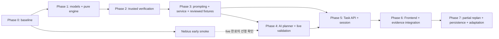

# ContextCue Backend Implementation Plan

> **Status:** 실행 순서와 진행 상태를 관리하는 Backend 작업 문서 (2026-10-21)
> **Current phase:** Phase 1 완료 — Phase 1.1–1.4 및 전체 완료 게이트 충족 (가정된 내부 입력에 한정)
> **Next task:** Phase 2 — 최소 action vocabulary 검토 후 trusted ActionPolicy/registry와 결정론적 검증 경계 구현
> **Parallel task:** Nebius Early Smoke Track — 접근 권한·API 연결·최소 JSON 출력 확인 (Phase 1 비차단)

이 문서는 새로운 개발 세션에서도 ContextCue Backend 작업을 안전한 순서로 이어가기 위한 실행 계획이다. 제품 범위는 `docs/PROJECT_PLAN.md`, 모듈과 데이터 경계는 `docs/SYSTEM_ARCHITECTURE.md`, 자동문 행동 기준은 `docs/scenarios/automatic-door.md`를 우선한다. 실제 구현 여부는 항상 코드와 테스트를 다시 확인한다.

## 1. 새 작업 세션에서 먼저 할 일

1. 루트 `AGENTS.md`, `backend/AGENTS.md`, `README.md`, `docs/TEAM_WORKFLOW.md`를 읽는다.
2. 이 문서와 현재 작업할 Phase에 연결된 `/docs` 문서를 읽는다.
3. `git status`와 `git branch --show-current`를 확인한다. 변경 사항을 버리거나 임의로 브랜치를 바꾸지 않는다.
4. 아래 **현재 구현 상태**와 실제 파일·테스트가 일치하는지 확인한다.
5. 완료되지 않은 가장 앞 Phase의 첫 체크박스부터 한 단위만 구현한다.
6. Backend 변경 후 `uv run pytest`와 `uv run ruff check .`를 `backend/`에서 실행한다.
7. 완료한 항목만 체크하고, 결과·제약·다음 작업을 이 문서에 갱신한다. 테스트를 실행하지 않았다면 완료로 표시하지 않는다.

현재 문서 작성 시점의 브랜치는 `docs/generic-task-engine-architecture`다. `main`의 `f43171a`를 병합한 `e78a752`가 로컬에 있으며, 문서 작성 시작 시 원격 기능 브랜치보다 2커밋 앞서 있었다. 이 정보는 스냅샷이므로 다음 세션에서는 Git 상태를 다시 확인해야 한다.

## 2. 현재 구현 상태

### 완료되어 있는 기반

- [x] FastAPI `GET /api/health`와 `POST /api/plan`
- [x] `PlanRequest`/`PlanResponse`, `Profile`, `SceneObject` Pydantic 계약
- [x] 정규화 bbox 범위와 scene object ID 중복 검사
- [x] `DEMO_RULES`와 선택적 `LIVE_NEBIUS` 경로 구분
- [x] 모델이 선택한 object ID의 grounding 및 label/대상 모호성 검사
- [x] 우유 가져오기에서 `can_grasp` 검사
- [x] 자동문 단일 단서에서 `can_press_button`과 `can_extend_arm` 검사 (`f43171a`)
- [x] live provider 실패를 demo 결과로 숨기지 않고 HTTP 502로 반환
- [x] Frontend의 별도 가방 챙기기 로컬 상태 머신과 도움 수준 0–4
- [x] 현재 Backend 회귀 기준: 2026-10-21 문서 정비 후 `uv run pytest` 46개 통과, `uv run ruff check .` 통과
- [x] Phase 1.1 내부 도메인 모델과 구조·참조 검증: 기존 46개 + 신규 56개 = 102개 테스트 및 Ruff 통과 (2026-10-21)

### Phase 1.1에서 추가된 내부 모델

- [x] 범용 `TaskPlan`, `TaskStep`, `TaskState`, `StepState`, `TaskEvent`, `Evidence` 데이터 모델
- [x] 의미적 `TargetRef`와 관찰 연결용 `TargetBinding`의 데이터 분리

위 모델은 기존 API에 연결되지 않았다. `TargetBinding`/`Evidence`의 형식 검증은 실제 관찰 진위·출처·freshness나 행동 완료를 입증하지 않는다.

### Phase 1.2에서 추가된 합성 계획 데이터

- [x] 자동문·가방 챙기기 JSON fixture를 같은 `TaskPlan`으로 검증하고 단계 순서·완료 목표 및 관찰/정책 필드 부재 확인
- [x] Phase 1.2 검증 기준: 기존 102개 + 신규 4개 = 106개 테스트 및 Ruff 통과 (2026-10-21)

두 fixture는 테스트용 의미적 계획이며 production template이나 실행·완료 검증 결과가 아니다. 시나리오별 Python 실행 파일은 추가하지 않았다.

### Phase 1.3에서 추가된 순수 제어 전이

- [x] 과제 독립 초기 상태 생성과 pause/resume/stop/refusal/more-help/help/manual-advance 처리
- [x] 입력 상태 보존, 단계와 도움 수준 분리, 무응답 시 상태 유지 및 잘못된 전이의 명시적 거부
- [x] Phase 1.3 검증 기준: 기존 106개 + 신규 74개 = 180개 테스트 및 Ruff 통과 (2026-10-21)

Phase 1.3은 제어 전이만 구현했다. 단계의 `active` 표시는 물리 행동 허가나 실제 완료를 뜻하지 않는다. binding/Evidence 처리와 완료 전이는 아래 Phase 1.4에서 추가했다.

### Phase 1.4에서 추가된 내부 Evidence와 완료 전이

- [x] 내부 `target_bound` 입력으로만 binding 갱신, Evidence의 append-only 기록 및 단계별 누적 이력 전달
- [x] 주입형 `CompletionEvaluator`와 근거 ID를 가진 `CompletionEvaluation`, 판정 결과 재검증과 satisfied/pending/conflicting 전이
- [x] 과제명·행동별 분기 없이 두 fixture를 같은 엔진/evaluator로 완료하고 단계 진입 시 도움 초기화
- [x] Phase 1.4 검증 기준: 기존 180개 + 신규 87개 = 267개 테스트 및 Ruff 통과 (2026-10-21)

Generic Task Engine의 Phase 1 구현은 완료했다. camera/caregiver 입력과 test evaluator는 상위 계층에서 검증됐다고 가정한 합성 데이터다. production Action/Completion Policy, 실제 관찰의 진위·출처·freshness 및 수행 가능성은 검증하지 않았다.

### 아직 구현되지 않은 목표

- [ ] 행동별 Trusted Action/Completion Policy
- [ ] production 행동 완료 Evidence 판정 (주입형 test evaluator를 통한 전이만 검증됨)
- [ ] Backend Prompting Policy와 Task orchestration
- [ ] 구조화된 AI Task Planner와 검증된 Template 선택
- [ ] Nebius Early Smoke와 실제 모델 접근/최소 JSON 검증
- [ ] 신규 Task lifecycle API와 세션 보관
- [ ] Frontend Task Engine 연결
- [ ] 실제 카메라/검출기, ASR, 음성 출력
- [ ] 부분 재계획, 장기 기억, Prompt Fading

### 현재 코드의 중요한 한계

- `app/planner.py`는 `retrieve_object`, `open_door`, `unknown`만 처리하는 단일 단서 planner다.
- 현재 `/api/plan`은 Task Plan이나 행동 결과를 반환하지 않는다.
- 현재 자동문 응답은 버튼 위치 찾기와 누르기 능력을 하나의 보수적 검사로 묶는다. 새 Task Engine에서는 `locate`와 `press`를 별도 단계로 모델링하되 레거시 API 동작을 무심코 변경하지 않는다.
- Frontend 가방 데모의 `next`와 `caregiver_confirm`은 다음 단계로 이동하지만 실제 Evidence를 저장하지 않는다. 화면의 `completed`는 관찰된 실제 완료가 아니다.
- 현재 장면은 `DEMO_SCENE` fixture이며 실제 카메라 인식이 아니다.
- `LIVE_NEBIUS` 호출 코드는 존재하지만 실제 모델 가용성·구조화 출력·지연은 검증되지 않았다.

## 3. 확정된 설계 결정

### 3.1 패키지와 의존 방향

- 새 Backend 기능은 하나의 `app/tasking/` 패키지에 둔다.
- `models.py`는 다른 `tasking` 모듈을 import하지 않는다.
- `engine.py`는 순수 상태 전이만 수행하며 FastAPI, AI provider, 과제명, 카메라를 알지 못한다.
- `service.py`가 planning → verification → engine → prompting 순서를 조정한다.
- Engine에는 `open_door`, `packing_bag` 같은 과제명별 분기를 넣지 않는다.
- 새 과제가 기존 action vocabulary를 조합하면 Engine 변경 없이 TaskPlan 데이터만 추가한다.
- 새로운 행동 의미가 필요할 때는 Engine이 아니라 trusted Action Policy를 확장한다.

### 3.2 unresolved target

- `TargetRef`는 `target_key`, 의미적 `concept`, 제한된 qualifier만 갖는다. 관찰 object ID와 bbox를 넣지 않는다.
- `TargetBinding`은 검증된 `object_id`와 `observation_revision`을 별도로 기록한다.
- 현재 binding은 `TaskState.target_bindings`에 저장한다.
- 물체가 아직 관찰되지 않아도 `TargetRef`는 유효하다. 텍스트·음성으로 찾기를 안내할 수 있다.
- highlight/arrow 또는 `press`, `grasp`, `place_inside` 같은 물리 행동은 유효한 binding 전에는 실행하지 않는다.
- AI가 향후 object ID 후보를 제안하더라도 현재 observation에서 확인된 뒤에만 binding으로 승격한다. 좌표는 언제나 observation에서 조회한다.

### 3.3 trusted completion

- AI/Template TaskPlan은 의미적 `CompletionGoal`만 선언한다.
- Plan은 허용 Evidence source, confidence threshold, 완료 quorum을 정하지 못한다.
- trusted `ActionPolicyRegistry`가 action별 허용 outcome, 필수 capability, binding 요구와 완료 Evidence 규칙을 제공한다.
- `manual_progress`, `cue_issued`, `model_assessment`, 무응답은 물리 행동의 완료 증거가 아니다.
- AI Verification 결과는 contextual assessment이며 관찰 Evidence가 아니다.
- 알 수 없거나 action과 맞지 않는 completion goal은 실행하지 않고 확인/거부한다.
- 완료 evaluator는 단순 `bool`이 아니라 아래의 작은 결과를 반환한다.

```text
CompletionEvaluation
  status: satisfied | pending | conflicting
  considered_evidence_ids: 평가에 사용한 Evidence ID
  supporting_evidence_ids: 완료를 지지한 Evidence ID
  conflicting_evidence_ids: 완료와 충돌한 Evidence ID
  reason_code: insufficient_evidence, criterion_satisfied, contradictory_evidence 등의 안정적인 코드
```

- `satisfied`만 단계 완료를 허용한다.
- `pending`은 `awaiting_evidence`를 유지한다.
- `conflicting`은 완료하지 않고 `needs_confirmation`으로 전환한다.
- `satisfied`에는 하나 이상의 supporting Evidence가 필요하고 conflicting Evidence가 없어야 한다. `conflicting`에는 하나 이상의 conflicting Evidence가 필요하다. `pending`은 아직 결정적 근거가 없음을 `reason_code`로 설명한다.
- 결과가 참조한 모든 Evidence ID는 현재 `TaskState.evidence`에 존재해야 하며 supporting/conflicting ID는 considered ID의 부분집합이어야 한다.
- 초기에는 점수 집계, rule graph, 설명 객체를 추가하지 않는다. Evidence ID와 reason code로 판정 근거를 추적할 수 있으면 충분하다.

### 3.4 상태와 도움

- Task 진행 상태와 prompt 도움 수준은 독립된 상태 축이다.
- 도움 수준은 명시적 사용자/보호자 요청 또는 신뢰 가능한 difficulty event로만 증가한다. 단순 무응답으로 자동 증가하지 않는다.
- 새 단계 진입 시 그 단계의 초기 도움 수준으로 재설정한다.
- `manual_advance`는 첫 구현에서 단계를 완료하거나 이동시키지 않고 `needs_confirmation`으로 전환한다.
- 마지막 단계까지 trusted completion을 만족해야만 Task가 `completed`가 된다.

### 3.5 Verification 순서

1. Pydantic 구조와 참조 무결성 검사
2. 존재하는 object binding의 ID·observation revision·모호성 검사
3. trusted Action Policy의 명시적 금지·필수 capability·completion 규칙 검사
4. 앞 단계가 통과했고 추가 맥락 판단이 필요한 경우에만 선택적 AI Verification
5. AI 결과 재검증 후 allow/confirm/assist/stop 중 안전한 결과 적용

AI는 앞 단계의 hard rejection을 뒤집거나 새 object ID, bbox, 행동 성공을 생성할 수 없다. unresolved target 자체는 오류가 아니지만, binding이 필수인 행동에서는 `awaiting_target` 또는 `needs_confirmation`으로 처리한다.

### 3.6 Phase 1과 Phase 2의 신뢰 경계

- Phase 1은 모델 형식과 상태 전이를 검증한다. 이 단계의 `TargetBinding`, `target_bound` 이벤트와 `Evidence`는 **상위 계층에서 검증되었다고 가정한 테스트 입력**이다.
- Phase 1에서 `source="camera_observation"`을 파싱하거나 test evaluator가 Evidence를 승인해도, 실제 카메라 관찰의 진위·출처·freshness를 입증한 것이 아니다.
- Phase 2가 외부 candidate binding/Evidence를 observation snapshot, revision, source 요구사항과 대조해 Engine에 전달 가능한 내부 입력으로 승격하는 신뢰 경계를 구현한다.
- 외부 입력을 신뢰할지 결정하는 정책과 Engine 진입 허용 책임은 Phase 2가 계속 소유한다. Phase 6의 카메라·보호자 입력 adapter는 검증 가능한 provenance를 제공하고 source별 end-to-end 검사를 추가할 뿐, 이 신뢰 결정을 우회하거나 대체하지 않는다.

## 4. 목표 디렉터리 구조

아래 파일을 한 번에 만들지 않는다. 각 Phase에서 필요한 파일만 추가한다.

```text
backend/
├── IMPLEMENTATION_PLAN.md
├── app/
│   ├── main.py                     # 기존 API 유지
│   ├── schemas.py                  # 기존 /api/plan 공개 계약
│   ├── planner.py                  # 기존 단일 단서 facade
│   ├── tasking/
│   │   ├── __init__.py
│   │   ├── models.py               # Phase 1
│   │   ├── engine.py               # Phase 1
│   │   ├── verification.py         # Phase 2
│   │   ├── prompting.py            # Phase 3
│   │   ├── service.py              # Phase 3
│   │   └── planning.py             # Phase 4
│   └── templates/                  # Phase 3 이후, 검토된 데이터만
│       └── automatic_door.v1.json
├── scripts/
│   └── nebius_smoke.py             # Early Smoke Track, opt-in live 확인
└── tests/
    ├── test_api.py
    ├── test_planner.py
    ├── test_task_models.py
    ├── test_task_engine.py
    ├── test_task_verification.py
    ├── test_task_prompting.py
    ├── test_task_service.py
    └── fixtures/
        └── plans/
            ├── automatic_door.json
            └── packing_bag.json
```

실제 카메라 등 복수 perception source가 생기기 전에는 `perception/` 패키지를 만들지 않는다. 새 route와 저장소 파일도 해당 Phase 전에는 추가하지 않는다.

## 5. Phase 의존 관계



Nebius early smoke는 Phase 1과 병행할 수 있다. 접근 실패나 계정 미준비는 Phase 1–3의 로컬 구현을 막지 않지만 `LIVE_NEBIUS` 성공이나 Phase 4의 live 완료를 주장할 수는 없다. AI가 만든 계획을 공개 Task API에서 사용하려면 Phase 2의 검증 경계도 먼저 완료되어야 한다.

## 6. Phase 0 — 기존 안전 기준선과 문서 정렬

**상태:** 완료

**목표:** 기존 `/api/plan`을 안전한 회귀 기준으로 보존하고 목표 구조와 현재 구현을 구분한다.

**완료 작업**

- [x] `/api/plan`의 객체 grounding, bbox, 중복 ID 검사 확인
- [x] `f43171a`의 자동문 `can_press_button` + `can_extend_arm` 검사와 테스트 반영
- [x] `DEMO_SCENE`, `DEMO_RULES`, `LIVE_NEBIUS` 용어 구분
- [x] 자동문 대표 시나리오와 가방 Frontend 데모의 역할 구분
- [x] Generic Task Engine 방향 합의
- [x] 단일 `tasking/` 패키지, unresolved target, trusted completion, verification 순서 합의
- [x] 상세 Backend 구현 계획 작성

**관련 파일**

- `app/main.py`
- `app/schemas.py`
- `app/planner.py`
- `tests/test_api.py`
- `tests/test_planner.py`
- `docs/PROJECT_PLAN.md`
- `docs/SYSTEM_ARCHITECTURE.md`

**완료 기준**

- 기존 Backend 회귀 테스트와 lint가 통과한다.
- 목표 기능을 구현 완료로 잘못 표시하지 않는다.
- 다음 작업이 Phase 1.1로 명시되어 있다.

## 6A. 병행 Track — Nebius Early Smoke

**상태:** 미실행 — Phase 1과 병행 가능, Phase 1 비차단

**목표:** 전체 AI Task Planner를 만들기 전에 현재 계정의 모델 접근 권한, API 연결, 최소 JSON 출력 가능성을 가장 작은 live 호출로 확인한다.

**선행 조건**

- Phase 0 완료
- 유효한 `NEBIUS_API_KEY`를 ignored `backend/.env`에만 보관
- 합성 request만 사용

**예상 수정 대상**

- `scripts/nebius_smoke.py` 신규
- 필요 시 `.env.example` 설명만 보완
- Smoke 결과 기록은 이 문서 또는 비밀정보가 없는 별도 문서

**작업**

- [ ] 별도 dependency 없이 기존 `AsyncOpenAI` 설정을 재사용하는 opt-in smoke entrypoint 추가
- [ ] 합성 scene의 기존 object ID 하나만 선택하는 최소 JSON schema로 호출하고, provider의 JSON/structured-output 옵션과 Pydantic 검증을 통과하는지 확인
- [ ] 자격 증명 누락, 인증/권한 오류, model unavailable, timeout, 빈 응답, JSON schema 오류, 성공을 구분
- [ ] 성공 시 실제 사용한 endpoint 구분, model ID, latency, schema 통과 여부만 기록
- [ ] API key, authorization header, raw 민감 prompt/response를 출력하거나 커밋하지 않음
- [ ] 실패 시 demo 결과로 fallback하지 않고 실패 유형을 그대로 보고

**테스트 및 완료 기준**

- [ ] 실제 호출이 성공하면 `LIVE_NEBIUS` smoke로 명시하고 최소 JSON이 현재 schema로 검증된다.
- [ ] 호출을 실행하지 않았거나 실패했다면 `not_run` 또는 `unavailable`로 기록하고 성공으로 체크하지 않는다.
- [ ] smoke 성공은 Generic TaskPlan 생성, 안전성, 실제 카메라 또는 행동 완료를 입증하지 않는다.
- [ ] smoke 결과와 무관하게 Phase 1 로컬 테스트 구현을 계속할 수 있다.

Phase 4에서는 이 결과를 출발점으로 TaskPlan 크기의 구조화 출력 안정성과 오류 처리를 다시 검증한다. Early smoke를 Phase 4 전체 완료로 간주하지 않는다.

## 7. Phase 1 — 최소 도메인 모델과 순수 Generic Task Engine

**상태:** 완료 — Phase 1.1–1.4 및 전체 완료 게이트 충족. 가정된 내부 입력과 합성 test evaluator 범위이며 production 검증은 미구현

**목표:** AI, API, DB 없이 범용 계획·상태·이벤트·증거 모델과 결정론적인 순수 상태 전이를 구현한다.

**선행 조건**

- Phase 0 완료
- 기존 `/api/plan` 계약을 변경하지 않기로 유지

### Phase 1.1 — 최소 모델

**상태:** 완료 (2026-10-21) — 아래 모델 형식과 참조 검증에 한정

**수정 대상**

- `app/tasking/__init__.py` 신규
- `app/tasking/models.py` 신규
- `tests/test_task_models.py` 신규

**작업**

- [x] `TargetRef`: 의미적 target만 표현하고 object ID/bbox 필드 금지
- [x] `TargetBinding`: `target_key`, `object_id`, `observation_revision`을 분리한 내부 데이터 형태 정의. Phase 1에서는 값이 상위 계층에서 검증되었다고 가정
- [x] `CompletionGoal`: outcome과 target key만 표현하고 Evidence source 정책 금지
- [x] `TaskStep`: step ID, action, target key, completion goal, 최대 도움 수준
- [x] `TaskPlan`: schema version, plan ID, goal, targets, 순서가 있는 steps
- [x] `Evidence`: 선언된 source, claim/outcome, target/object 참조, supports/contradicts/inconclusive. Phase 1에서는 source 문자열의 진위를 검증하지 않음
- [x] `TaskEvent`: pause/resume/stop/refusal/more-help/help/manual-advance/cue-issued/target-bound/evidence-received
- [x] `StepState`와 `TaskState`: 단계 상태, 현재 단계, 독립 help level, binding, evidence
- [x] Pydantic model은 mutable default를 공유하지 않고 알 수 없는 제어 필드를 거부

**테스트 및 완료 기준**

- [x] object ID가 없는 unresolved `TargetRef`가 유효하다.
- [x] `TargetRef`에 bbox/object ID를 직접 넣으면 거부한다.
- [x] 중복 target/step ID와 존재하지 않는 target key 참조를 거부한다.
- [x] Plan이 allowed Evidence sources나 confidence threshold를 지정할 수 없다.
- [x] 모델 round-trip과 기본값 독립성을 검증한다.
- [x] `TargetBinding`/`Evidence` 모델 검증이 실제 관찰 진위나 source 신뢰성을 입증하지 않는다는 테스트 설명을 남긴다.

**구현 선택과 인수인계**

- 변경 파일: `app/tasking/__init__.py`, `app/tasking/models.py`, `tests/test_task_models.py`, 이 계획서.
- 실제 검사: `backend/`에서 `uv run pytest` **102 passed** (기존 API/planner 46개 + 모델 56개), `uv run ruff check .` **All checks passed!**.
- 기존 FastAPI TestClient의 Starlette deprecation warning 1개와 uv의 `SSL_CERT_DIR` 인증서 경고가 있었으나 두 명령 모두 exit code 0이었다. 이 작업에서 dependency/환경 설정은 변경하지 않았다.
- `schema_version="1.0"`, `target_keys` 목록과 `outcome`은 설계 예시를 따른다. qualifier는 현재 `color`/`relative_position` 텍스트만 허용한다.
- 상태는 `current_step_id`와 단계별 `StepState.help_level`을 별도 보관한다. 초기 도움 수준은 0, 단계별 최대 기본값은 4이며 이 내부 기본값은 Frontend/자동문 도움 척도를 통합한다는 뜻이 아니다.
- 이벤트 이름은 설계안의 snake_case(`more_help`, `help_requested`, `manual_advance` 등)를 사용한다. 이벤트별 payload 형식만 검증하고 상태 전이를 실행하지 않는다.
- `observation_revision`은 비어 있지 않은 문자열 참조다. action/outcome 지원 여부, capability, target cardinality, binding freshness/source provenance 및 완료 판정은 구현하지 않았으며 후속 Phase의 책임이다.
- 증거 구분: 모든 신규 입력은 합성 데이터다. 기존 `DEMO_RULES` 회귀 테스트만 실행했으며 실제 `DEMO_SCENE` 감지나 `LIVE_NEBIUS` 호출은 실행하지 않았다. Early Smoke는 `not_run`이다.
- 범위 확인: `app/main.py`, `app/schemas.py`, `app/planner.py`, Frontend와 dependencies는 변경하지 않았다. Engine, CompletionEvaluation, 과제 fixture, trusted verification, 신규 API는 추가하지 않았다. commit/push하지 않았다.
- 바로 다음 작업: **Phase 1.2만** 진행하여 두 JSON fixture를 같은 `TaskPlan`으로 검증한다. Phase 1 전체 완료로 표시하지 않는다.

### Phase 1.2 — 두 과제 fixture

**상태:** 완료 (2026-10-21) — 합성 계획 데이터와 모델 검증에 한정

**수정 대상**

- `tests/fixtures/plans/automatic_door.json` 신규
- `tests/fixtures/plans/packing_bag.json` 신규
- `tests/test_task_models.py`

**작업**

- [x] 자동문을 `locate_button → press_button → confirm_open → pass_through`로 표현
- [x] 가방 챙기기를 `locate_bag → locate_bottle → place_bottle → verify_items`로 표현
- [x] 두 fixture 모두 특정 관찰 object ID 없이 semantic target으로 시작
- [x] `complete` pseudo-step을 만들지 않고 마지막 행동의 trusted completion으로 Task 종료

마지막 항목은 별도 완료 단계를 두지 않는 **계획 데이터 구조**를 충족했다는 뜻이다. 실제 Task 종료 전이와 trusted completion 실행은 각각 Phase 1.4와 Phase 2에서 구현·검증한다.

**테스트 및 완료 기준**

- [x] 두 JSON이 동일한 `TaskPlan` 모델로 검증된다.
- [x] fixture 안에 bbox나 관찰 object ID가 없다.
- [x] 시나리오별 Python 실행 파일이 없다.

**구현 선택과 인수인계**

- 변경 파일: `tests/fixtures/plans/automatic_door.json`, `tests/fixtures/plans/packing_bag.json`, `tests/test_task_models.py`, 이 계획서. 이전 Phase 1.1의 미커밋 변경은 보존했다.
- 실제 검사: `backend/`에서 `uv run pytest` **106 passed** (기존 102개 + fixture 검증 4개), `uv run ruff check .` **All checks passed!**. 기존 Starlette deprecation warning 1개와 uv의 `SSL_CERT_DIR` 경고는 동일하며 두 명령 모두 exit code 0이었다. `git diff --check`도 통과했다.
- 두 fixture는 `locate`, `press`, `observe_state`, `traverse`, `place_inside`를 데이터로 조합한다. 자동문 마지막 목표는 `passed_through`, 가방 마지막 목표는 `items_inside`다. 가방의 `place_inside`는 `target_keys=["bottle", "bag"]`로 넣을 물체와 목적 용기를 순서대로 참조하고 `placed_inside`를 목표로 선언한다.
- 가방의 새 outcome 이름은 fixture의 의미적 목표이며 trusted Action Policy가 승인한 vocabulary는 아니다. action/outcome 지원·필수 능력·도달 가능성·출처·완료 정책은 후속 Phase에서 검증해야 한다. Frontend의 기존 5단계 가방 데모와 연결하지 않았다.
- 증거 구분: 합성 계획 데이터만 추가했다. 기존 `DEMO_RULES` 회귀 테스트를 실행했으며 `DEMO_SCENE` 관찰 수집이나 `LIVE_NEBIUS` 호출은 실행하지 않았다. Early Smoke는 `not_run`이다.
- 범위 확인: 이번 작업은 모델·Engine·trusted verification·API·Frontend·dependencies를 변경하거나 추가하지 않았다. commit/push하지 않았다.
- 바로 다음 작업: **Phase 1.3만** 진행하여 초기 상태 및 pause/resume/stop/refusal/help/manual-advance의 순수 제어 상태 전이를 구현한다. Phase 1 전체 완료 게이트는 미완료로 유지한다.

### Phase 1.3 — 제어 상태 전이

**상태:** 완료 (2026-10-21) — 순수 제어 전이에 한정

**수정 대상**

- `app/tasking/engine.py` 신규
- `tests/test_task_engine.py` 신규

**작업**

- [x] 초기 `TaskState` 생성
- [x] pause/resume, stop, refusal 처리
- [x] 명시적인 more-help/help 요청 처리
- [x] 단계와 help level을 독립적으로 관리
- [x] 무응답으로 상태가 변하지 않도록 보장
- [x] `manual_advance`는 이동하지 않고 `needs_confirmation`으로 전환
- [x] invalid transition은 상태를 손상시키지 않는 명확한 결과로 반환

**테스트 및 완료 기준**

- [x] pause 중 진행 이벤트가 차단되고 resume 후 재개된다.
- [x] stop/refusal 후 terminal 상태에서 진행하지 않는다.
- [x] more-help 이벤트에서만 help level이 증가하고 상한을 넘지 않는다.
- [x] 단계 번호 변경 없이 help level만 변할 수 있다.
- [x] 무응답을 나타내는 이벤트/호출 부재는 실패나 도움 증가가 아니다.

**구현 선택과 인수인계**

- 변경 파일: `app/tasking/engine.py`, `tests/test_task_engine.py`, 이 계획서. 이전 Phase 1.1–1.2의 미커밋 변경은 보존했다.
- 실제 검사: `backend/`에서 `uv sync --group dev` 성공, `uv run pytest` **180 passed** (기존 106개 + 제어 전이 74개), `uv run ruff check .` **All checks passed!**. 기존 Starlette deprecation warning 1개와 uv의 `SSL_CERT_DIR` 경고는 동일하며 검사 명령은 모두 exit code 0이었다.
- 인터페이스: `create_task_state(plan, task_id)`는 첫 단계만 `active`, 나머지는 `pending`, 단계별 도움은 0으로 생성한다. `apply_event(plan, state, event=None)`는 입력과 중첩 mutable 값을 공유하지 않는 새 상태 및 `TransitionResult(state, accepted, reason_code)`를 반환한다. 실패 시 상태 내용은 유지한다.
- `more_help`는 현재 단계의 도움만 최대 `max_help_level`까지 올린다. 상한에서 `help_limit_reached`로 상태를 유지한다. `help_requested`는 도움 수준 증가 없이 `needs_assistance`, `manual_advance`는 단계 이동 없이 `needs_confirmation`으로 전환한다.
- pause는 `active`에서만, resume은 정상 현재 단계를 가진 `paused`에서만 허용한다. 단계 내부 상태와 도움은 보존한다. 확인/보조 필요 상태를 pause/resume으로 해제하지 않으며 이 상태의 승인·해제 정책은 추가하지 않았다.
- stop/refusal/help 요청은 terminal이 아닌 상태에서 task 전체에 적용한다. 오래된 step hint, plan 불일치나 도움 상한 오류로 중단·거부·보조 요청을 차단하지 않는다. 그 외 제어는 plan/단계 일치와 도움 범위를 검사한다. `stopped`/`completed`는 모든 실제 이벤트를 거부한다.
- `event=None`은 무응답/이벤트 부재를 뜻하는 no-op이며 실패나 도움 증가를 만들지 않는다. `cue_issued`, `target_bound`, `evidence_received`는 이번 Phase에서 `unsupported_event`로 거부한다. binding/Evidence 기록·완료 evaluator·다음 단계 이동은 구현하지 않았다.
- 두 합성 fixture에 같은 엔진 테스트를 적용했다. 테스트의 후속 단계/`completed` 상태와 기존 binding/Evidence는 상태 보존 검사용 가정된 입력일 뿐, 엔진이 실제 행동을 완료하거나 source 신뢰성을 검증했다는 증거가 아니다.
- 증거 구분: 합성 제어 상태 테스트와 기존 `DEMO_RULES` 회귀 테스트만 실행했다. `DEMO_SCENE` 관찰 수집과 `LIVE_NEBIUS` 호출은 실행하지 않았다. Early Smoke는 `not_run`이다.
- 범위 확인: 모델·fixture·기존 API·Frontend·dependencies는 이번 작업에서 변경하지 않았다. Phase 1.4, trusted verification, AI, 신규 API, DB를 추가하지 않았고 commit/push하지 않았다.
- 바로 다음 작업: **Phase 1.4만** 진행하여 가정된 binding/Evidence 기록과 `CompletionEvaluation`/주입형 evaluator 및 완료 전이를 구현한다. Phase 1 전체 완료 게이트는 미완료로 유지한다.

### Phase 1.4 — 가정된 binding/Evidence와 완료 전이

**상태:** 완료 (2026-10-21) — 모델 형식·내부 가정 입력·순수 상태 전이에 한정

**수정 대상**

- `app/tasking/engine.py`
- `tests/test_task_engine.py`

**작업**

- [x] 상위 계층에서 검증되었다고 가정한 내부 `target_bound` 이벤트로만 `TaskState.target_bindings` 갱신
- [x] Evidence를 append-only 기록으로 상태에 추가
- [x] Engine이 action 의미를 하드코딩하지 않도록 CompletionEvaluator(step, evidence_history) -> CompletionEvaluation callable/protocol을 주입한다. evidence_history는 현재 단계에 관련된 누적 Evidence를 의미한다.
- [x] `CompletionEvaluation`은 `status`, considered/supporting/conflicting Evidence ID, `reason_code`만 갖는 작은 결과로 정의
- [x] 결과가 참조한 Evidence ID의 존재 여부, supporting/conflicting이 considered의 부분집합인지, status별 최소 근거 조건을 검증
- [x] `satisfied`에서만 단계 완료 및 다음 단계 이동
- [x] `pending`에서는 현재 단계와 `awaiting_evidence` 유지
- [x] `conflicting`에서는 완료하지 않고 `needs_confirmation`으로 전환
- [x] 다음 단계 진입 시 help level 초기화
- [x] 모든 단계가 trusted completion을 충족한 경우에만 Task 완료

**테스트 및 완료 기준**

- [x] unresolved target을 포함한 계획을 시작할 수 있다.
- [x] `cue_issued`, `manual_progress`, `model_assessment`, inconclusive Evidence가 완료시키지 않는다.
- [x] test evaluator의 `pending` 결과가 단계와 help level을 유지한다.
- [x] test evaluator의 `conflicting` 결과가 근거 Evidence ID를 보존하고 확인 상태로 전환한다.
- [x] test evaluator의 `satisfied` 결과만 단계를 완료한다.
- [x] 존재하지 않는 Evidence ID, 근거 목록의 잘못된 포함 관계, status와 맞지 않는 근거 조합을 거부한다.
- [x] camera/caregiver로 표시된 Evidence는 테스트에서 검증된 것으로 가정한 입력일 뿐이며 실제 source 신뢰성의 증거로 표현하지 않는다.
- [x] 자동문과 가방 fixture가 같은 Engine과 evaluator 인터페이스를 사용한다.
- [x] Engine에 task 이름별 분기가 없다.

**구현 선택과 인수인계**

- 변경 파일: `app/tasking/engine.py`, `tests/test_task_engine.py`, 이 계획서. 이전 Phase 1.1–1.3의 미커밋 변경은 보존했다.
- 실제 검사: `backend/`에서 `uv sync --group dev` 성공, `uv run pytest` **267 passed** (기존 180개 + 신규 87개), `uv run ruff check .` **All checks passed!**. 기존 Starlette deprecation warning 1개와 uv의 `SSL_CERT_DIR` 경고만 남았으며 명령은 모두 exit code 0이었다. `git diff --check` 통과 및 기존 API/Frontend/dependency 파일의 diff 부재를 확인했다.
- `CompletionEvaluation`/`CompletionEvaluator`는 이번 Phase의 수정 대상인 `engine.py`에 정의했다. `apply_event(..., evaluator=...)`는 현재 단계의 누적 Evidence만 깊은 복사로 전달한다. `TransitionResult.evaluation`으로 considered/supporting/conflicting ID와 reason code를 반환하며, 상태는 원본 Evidence 이력을 보존한다.
- 내부 binding은 선언된 target key만 허용하고 값은 복사한다. 실제 object ID 존재·revision freshness는 검증하지 않는다. Evidence는 현재 단계/target 참조와 ID 중복을 검사한 뒤 append하며, 누락 evaluator에서는 `awaiting_evidence`를 유지한다.
- cue 발행은 완료 판정기를 호출하거나 성공 Evidence를 생성하지 않고 `awaiting_evidence`로만 전환한다. manual/cue/model/unknown source와 inconclusive claim은 완료 지지 근거로 승격할 수 없다. 이는 공통 허위 완료 방지 조건이며 action별 source 허용·confidence·provenance 정책 구현이 아니다.
- 평가 결과를 다시 Pydantic 검증하고, 근거 ID는 현재 단계 이력 안에 존재해야 한다. 지지/충돌 목록은 considered의 서로 겹치지 않는 부분집합이어야 하며, 각 근거의 supports/contradicts relation도 확인한다. `satisfied`는 지지 근거와 충돌 부재, `conflicting`은 충돌 근거를 요구하고 `pending`은 충돌 목록을 허용하지 않는다.
- `pending`은 단계/도움 수준을 유지하고, `conflicting`은 Evidence와 판정 근거를 보존하며 `needs_confirmation`으로 전환한다. 잘못된 판정이나 evaluator 예외도 받은 Evidence를 삭제하지 않고 확인 상태로 전환하며 `accepted=false`와 이유 코드를 반환한다. 다른 입력/제어 거부는 기존 상태를 보존한다.
- `satisfied`에서만 현재 단계를 완료하고 다음 단계 도움을 0으로 초기화한다. 이전 단계가 모두 완료되고 이후 단계가 대기 중인지 검사해 단계 건너뛰기를 거부하며, 마지막 단계 완료 시 `status=completed`, `current_step_id=None`으로 종료한다. 확인/보조 필요 상태의 해제 정책은 추가하지 않았다.
- 두 fixture가 동일한 엔진과 합성 test evaluator로 끝까지 전이했다. 이 결과는 source label의 진위, 실제 센서, 신체 수행 가능성이나 production 완료 정책을 입증하지 않는다. `DEMO_RULES` 회귀 테스트는 실행했으며 `DEMO_SCENE` 관찰 수집과 `LIVE_NEBIUS` 호출은 실행하지 않았다. Early Smoke는 `not_run`이다.
- 범위 확인: 기존 공개 API·모델·fixture·Frontend·dependencies는 이번 작업에서 변경하지 않았다. PlanPatch, AI, 신규 API, DB, production Verification Agent는 추가하지 않았고 commit/push하지 않았다.
- 바로 다음 작업: **Phase 2**에서 action vocabulary를 검토하고 trusted Action/Completion Policy 및 외부 candidate를 내부 입력으로 승격하는 검증 경계를 구현한다. 이번 작업에서는 Phase 2를 시작하지 않았다.

### Phase 1 전체 완료 게이트

- [x] `app/main.py`, `app/schemas.py`, `app/planner.py`, Frontend를 변경하지 않았다.
- [x] `PlanPatch`, AI, 신규 API, DB, production Verification Agent를 추가하지 않았다.
- [x] Phase 1 테스트가 실제 관찰의 진위·출처 또는 production completion policy를 검증한다고 주장하지 않는다.
- [x] `uv run pytest` 통과
- [x] `uv run ruff check .` 통과
- [x] 실제 테스트 수와 결과를 이 문서의 진행 상태에 기록

## 8. Phase 2 — Trusted Action/Completion Policy와 결정론적 Verification

**상태:** 미구현

**목표:** AI 계획이나 Evidence가 명시적 안전 제약과 완료 규칙을 우회하지 못하게 한다.

이 Phase부터 외부의 candidate binding/Evidence를 그대로 Engine에 넣지 않고 검증된 내부 입력으로 승격한다. Phase 1의 모델과 test evaluator는 이 신뢰 경계를 대신하지 않는다.

**선행 조건**

- Phase 1 완료
- 최소 action vocabulary 검토

**수정 대상**

- `app/tasking/verification.py` 신규
- `app/tasking/models.py`
- `app/tasking/engine.py`의 evaluator 연결부
- `tests/test_task_verification.py` 신규
- 필요 시 `tests/test_task_engine.py`

**작업 순서**

- [ ] `ActionPolicy`와 작은 registry 정의
- [ ] 초기 generic action: `locate`, `press`, `observe_state`, `traverse`, `place_inside`
- [ ] action별 target cardinality와 binding 요구 정의
- [ ] action별 필수 capability와 false/unknown 처리 정의
- [ ] action별 허용 `CompletionGoal`과 Evidence source 정의
- [ ] Plan 구조/참조 검증 → binding 검증 → capability/hard constraint 검사 순서 구현
- [ ] candidate `TargetBinding`의 object ID와 observation revision을 현재 observation snapshot에 대조
- [ ] Evidence의 선언된 source에 필요한 provenance 필드와 trusted policy 허용 여부 검사
- [ ] 검증을 통과한 binding/Evidence만 Engine용 내부 event로 변환
- [ ] 기존 `Profile`을 내부 capability fact로 변환하는 adapter 구현
- [ ] unsupported action/outcome/capability key를 안전하게 거부
- [ ] AI Verification은 아직 구현하지 않고 `context_review_required` 같은 결과만 표현

**테스트 및 완료 기준**

- [ ] `locate`는 unresolved target을 허용하고 누르기 능력을 요구하지 않는다.
- [ ] `press`는 binding 및 `can_press_button`/`can_extend_arm`을 요구한다.
- [ ] false capability는 assistance/stop, unknown은 confirmation으로 구분된다.
- [ ] AI/Plan이 manual 또는 model Evidence를 완료 source로 만들 수 없다.
- [ ] stale/unknown object binding이 거부되고 좌표는 생성되지 않는다.
- [ ] source 이름만 camera/caregiver로 바꾼 Evidence가 자동으로 신뢰되지 않는다.
- [ ] 누락되거나 일치하지 않는 observation revision/provenance가 거부 또는 confirmation으로 전환된다.
- [ ] 구조 또는 hard constraint 실패 시 AI 호출 지점에 도달하지 않는다.
- [ ] 기존 `/api/plan` 46개 회귀 테스트를 유지한다.

Phase 2가 외부 관찰의 진위·출처를 판정하는 정책과 Engine 진입 경계를 소유한다. 다만 실제 카메라 서명이나 보호자 인증처럼 source adapter가 있어야 제공할 수 있는 provenance는 Phase 6에서 연결하고 같은 Phase 2 정책으로 검증한다. 따라서 adapter 없이 끝낸 Phase 2는 실제 센서가 신뢰 가능함을 입증한 것이 아니라, 가짜·누락 provenance를 안전하게 거부할 계약을 강제한 상태다.

## 9. Phase 3 — Prompting Policy, Service orchestration, 검토된 fixture/template

**상태:** 미구현

**목표:** 검증된 단계에 대해 한 번에 하나의 단서를 고르고, 외부 부작용 없이 전체 실행 순서를 조정한다.

**선행 조건**

- Phase 2 완료

**수정 대상**

- `app/tasking/prompting.py` 신규
- `app/tasking/service.py` 신규
- `app/templates/automatic_door.v1.json` 선택적 신규
- `tests/test_task_prompting.py` 신규
- `tests/test_task_service.py` 신규

**작업 순서**

- [ ] help level과 사용자 guidance 선호를 입력으로 받는 순수 Prompting Policy 구현
- [ ] unresolved target에는 좌표 기반 cue를 생성하지 않음
- [ ] bound target cue도 object ID만 전달하고 bbox는 observation lookup에서 가져오게 함
- [ ] cue 발행과 행동 완료를 별도 이벤트로 기록
- [ ] Task Service가 verification → engine → prompting 순서를 조정
- [ ] step 진입과 context 변경에서 재검증하도록 orchestration 정의
- [ ] 자동문 fixture를 검토한 뒤 production template 승격 여부 결정
- [ ] Template 사용 시 source/version을 명시

**테스트 및 완료 기준**

- [ ] 한 번에 cue 하나만 반환한다.
- [ ] 무응답만으로 help level을 올리지 않는다.
- [ ] cue 발행이 step completion을 만들지 않는다.
- [ ] invalid/unbound target에 highlight bbox를 반환하지 않는다.
- [ ] Task Service 테스트는 AI, 네트워크, DB 없이 실행된다.

## 10. Phase 4 — 구조화된 AI Task Planner와 실제 모델 검증

**상태:** 미구현

**목표:** 목표·프로필·관찰을 바탕으로 TaskPlan 제안을 생성하되 trusted verification 밖에서는 실행하지 않는다.

**선행 조건**

- Phase 2 완료
- Phase 3의 service 경계 확정
- Early Smoke Track을 적어도 한 번 시도하고 결과를 `passed`, `unavailable`, `not_run` 중 하나로 기록
- live 통합 완료를 주장하려면 Early Smoke가 실제 Nebius 계정과 대상 모델에서 `passed`

**수정 대상**

- `app/tasking/planning.py` 신규
- `app/planner.py`는 호환 facade로 필요한 만큼만 수정
- `tests/test_task_planning.py` 신규
- `tests/test_planner.py` 회귀 유지
- `.env.example`은 새 설정이 실제로 필요할 때만 수정

**작업 순서**

- [ ] Planner 입력에서 transcript를 untrusted data로 취급
- [ ] AI 출력 schema를 `TaskPlan` 제안으로 제한
- [ ] semantic `TargetRef`와 unresolved target을 지원
- [ ] AI가 bbox와 완료 Evidence를 생성하지 못하도록 출력 계약 제한
- [ ] 잘못된 JSON, unknown action, 허위 candidate object ID 처리
- [ ] 검증된 Template 선택과 AI 생성 source를 명시적으로 구분
- [ ] live 호출 실패 시 `DEMO_RULES`로 몰래 fallback하지 않음
- [ ] Early Smoke에서 확인한 endpoint/model을 사용해 TaskPlan 크기의 JSON 안정성, latency, 오류 처리 재검증

**테스트 및 완료 기준**

- [ ] mock provider로 정상/잘못된 JSON/timeout/unknown ID 경로 검증
- [ ] AI 제안은 Phase 2 verification을 통과하기 전 Engine에 들어가지 않는다.
- [ ] AI가 completion policy를 완화할 수 없다.
- [ ] 실제 live 검증을 했다면 재현 가능한 비밀정보 없는 결과를 기록한다.
- [ ] live 검증을 하지 않았다면 `LIVE_NEBIUS` 완료로 표시하지 않는다.

Early Smoke가 `unavailable`이어도 mock provider를 이용한 planning 구조와 검증 테스트는 진행할 수 있다. 단, 실제 모델 관련 체크박스와 Phase 4의 live 완료 조건은 열린 상태로 남긴다.

## 11. Phase 5 — Task lifecycle API와 세션 경계

**상태:** 미구현

**목표:** 기존 `/api/plan`을 유지하면서 Generic Task 기능을 별도 versioned API로 노출한다.

**선행 조건**

- Phase 3 완료
- AI 계획을 공개 경로에 쓸 경우 Phase 4 완료
- 세션 저장 방식 결정

**예상 수정 대상**

- `app/main.py` 또는 별도 route 모듈
- `app/schemas.py` 또는 합의된 Task API schema 파일
- `app/tasking/service.py`
- 신규 API 계약 테스트
- 공개 계약 변경 시 `frontend/src/types.ts`

**작업 순서**

- [ ] in-memory server session과 재검증 가능한 stateless state 중 초기 방식을 결정
- [ ] task 생성/조회/event 입력 endpoint 계약 확정
- [ ] event 중복·순서 오류를 다룰 state version 규칙 결정
- [ ] 잘못된 event와 stale observation에 안전한 응답 정의
- [ ] `/api/plan` 계약과 status 값을 변경하지 않음
- [ ] 새 공개 필드를 Backend/Frontend 타입과 테스트에서 함께 갱신

**테스트 및 완료 기준**

- [ ] 레거시 `/api/plan` 요청·응답이 기존과 호환된다.
- [ ] Task API에서 pause/resume/stop/help/evidence 정상·오류 경로가 검증된다.
- [ ] cue/manual input만으로 completed 응답이 나오지 않는다.
- [ ] 프로세스 재시작 또는 다중 worker 한계를 문서화한다.

## 12. Phase 6 — Frontend 및 Observation/Evidence 연결

**상태:** 미구현

**목표:** 자동문 대표 시나리오와 가방 교차 시나리오를 Backend Engine에 연결한다.

**선행 조건**

- Phase 5 완료
- Frontend 담당자와 공유 계약 협의

**예상 수정 대상**

- Backend Task API/adapter 및 테스트
- `frontend/src/types.ts`
- `frontend/src/packing/`와 관련 components
- 자동문 UI/scene 관련 파일
- 필요할 때만 observation adapter 모듈

**작업 순서**

- [ ] Frontend `next`를 성공이 아닌 manual advance 요청으로 전송
- [ ] caregiver 확인에 step, claim, target, source를 포함
- [ ] `completed`와 `needs_confirmation`을 UI에서 구분
- [ ] `DEMO_SCENE` fixture와 실제 perception source를 명확히 표시
- [ ] 자동문 장면에 문 상태와 통과 확인에 필요한 합성 관찰 추가
- [ ] 사용자 A/B의 capability 차이를 E2E로 검증

**테스트 및 완료 기준**

- [ ] Backend pytest/Ruff 통과
- [ ] Frontend typecheck/build 통과
- [ ] 정상·불확실·불가능·거부·중단 경로 확인
- [ ] 자동문과 가방이 동일 Backend Engine을 사용한다.
- [ ] manual QA와 실제 카메라 검증 여부를 별도로 기록한다.

## 13. Phase 7 — 후순위 확장

**상태:** 보류

다음 항목은 Phase 1–6의 계약과 측정 결과가 안정된 뒤 별도 작업으로 진행한다.

- [ ] `PlanPatch`와 현재 단계 이후 suffix 부분 재계획
- [ ] 완료 이력과 Evidence를 보존하는 plan revision 규칙
- [ ] durable persistence 또는 DB
- [ ] 실제 perception/ASR/audio TTS adapter
- [ ] 선택적 독립 Verification Agent
- [ ] 장기 Memory와 증거 기반 Prompt Fading
- [ ] 복수 worker, concurrency, event idempotency 강화

각 항목은 별도 설계·위험 검토 없이 앞 Phase에 끼워 넣지 않는다.

## 14. 호환성 및 안전 체크리스트

모든 Phase에서 다음을 유지한다.

- [ ] 기존 `/api/plan` 변경 시 `app/schemas.py`, `frontend/src/types.ts`, 호출부와 계약 테스트를 같은 변경 단위로 갱신한다.
- [ ] bbox는 검증된 observation에서만 반환한다.
- [ ] AI가 임의 object ID, bbox, 행동 성공을 만들지 못한다.
- [ ] `false`와 `unknown` capability를 `true`로 취급하지 않는다.
- [ ] locate 같은 인지적 단계와 press/place 같은 물리적 단계를 분리한다.
- [ ] cue 발행, manual progress, Evidence, 실제 완료를 각각 기록한다.
- [ ] Evidence의 source label만으로 진위가 증명되었다고 간주하지 않고 Phase 2/6의 검증 경계를 통과시킨다.
- [ ] `DEMO_SCENE`, `DEMO_RULES`, `LIVE_NEBIUS`를 구분한다.
- [ ] Nebius smoke 실패가 로컬 Task Engine 개발을 막지 않으며, smoke 성공만으로 AI Planner 전체 완료를 주장하지 않는다.
- [ ] live provider 오류를 demo 성공처럼 표시하지 않는다.
- [ ] 합성 프로필·장면과 합의된 성인 시연만 사용한다.
- [ ] API key, 실제 장애 기록, 학생 영상, private identifier를 커밋하거나 로그에 남기지 않는다.

## 15. 아직 확정하지 않은 사항

다음은 해당 Phase에서 근거와 테스트를 바탕으로 결정한다.

1. 초기 action vocabulary의 최종 이름과 세부 parameter 형식
2. caregiver report와 camera Evidence의 충돌 및 confidence 처리
3. 실제 target binding의 freshness/추적 기준
4. Task API 세션 저장 방식과 state version/idempotency 계약
5. AI context verification 호출 기준과 latency budget
6. Template 검토·versioning·승격 절차
7. 실제 입력 장치, 비접촉 거부/도움 UX
8. 장기 기억과 Prompt Fading에 필요한 반복 Evidence 기준

미결 사항을 구현 편의로 임의 확정하지 않는다. 필요한 Phase에서 선택지, 근거, 테스트 결과를 문서화한다.

## 16. Phase 완료 시 인수인계 형식

각 작업 종료 시 이 문서에 다음을 남긴다.

```text
완료한 체크박스:
변경 파일:
실행한 검사와 실제 결과:
DEMO_SCENE / DEMO_RULES / LIVE_NEBIUS 여부:
알려진 제한 또는 미결 결정:
바로 다음 작업:
```

체크박스는 코드 존재만으로 완료 처리하지 않는다. 해당 Phase의 테스트 및 완료 기준을 실제로 충족했을 때만 `[x]`로 바꾼다.
