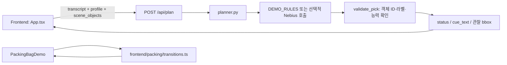
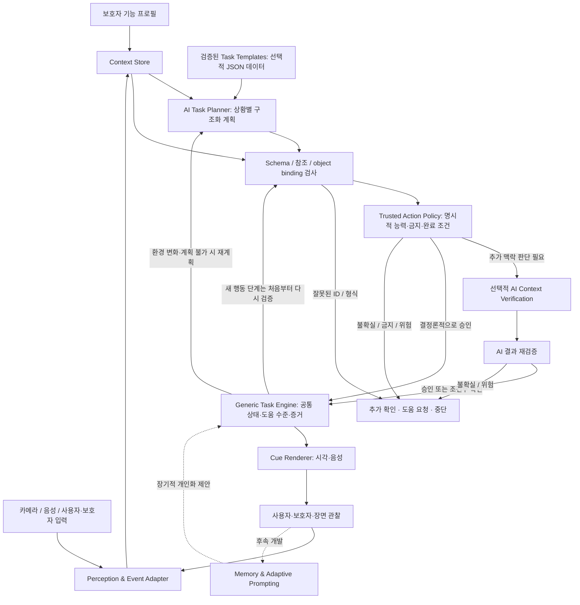

# ContextCue — System Architecture

> **Status:** 범용 과제 실행 설계안 + 현재 구현 차이 기록 (2026-10-21, v0.4)
> 제품의 목표와 MVP 우선순위는 [PROJECT_PLAN.md](PROJECT_PLAN.md), 자동문 행동 규칙은 [scenarios/automatic-door.md](scenarios/automatic-door.md)에서 정의한다.
> 단계별 Backend 작업과 최신 진행 상태는 [`backend/IMPLEMENTATION_PLAN.md`](../backend/IMPLEMENTATION_PLAN.md)에서 관리한다.

## 1. 책임 분리 원칙

- **Profile-first:** 사람이 입력한 능력·선호 프로필을 사용한다. 모델이 장애 정도나 운동 능력을 자동 진단하지 않는다.
- **Observation-grounded:** 물체 위치는 카메라/검출기 또는 `DEMO_SCENE` fixture에서 오며, LLM이 생성한 좌표는 렌더러에 전달하지 않는다.
- **Hybrid Verification:** 사용자 프로필, 장면 관찰, AI 기반 맥락 추론을 종합해 실제 수행 가능성과 불확실성을 평가한다. 명시적인 금지·능력 제약 및 객체 ID·좌표 유효성은 코드로 강제한다. 별도 검증 에이전트는 선택적인 확장이지 필수 구성요소가 아니다. 근거가 부족하면 확인·도움·중단을 택한다.
- **Generalizable Task Execution:** 과제별 Python 실행기를 늘리지 않는다. AI가 구조화된 행동 계획을 생성하고 **Generic Task Engine**이 공통 상태·도움·증거를 관리한다. 빈번한 과제는 검증된 데이터 Template을 재사용할 수 있다.
- **One cue at a time:** 다음 행동 하나와 도움 수준을 선택한다. 안내를 제공한 사실을 성공으로 간주하지 않는다.
- **Human-in-the-loop:** 미확인, 불가능, 거부, 위험은 확인/도움/중단으로 전환한다.
- **Reality over aspiration:** 아래 '현재'와 '목표'를 엄격히 구분한다.

## 2. 현재 구현 경로 (2026-10-21 main 기준)



- **Backend:** `backend/app/main.py`는 `GET /api/health`, `POST /api/plan`을 제공한다. `schemas.py`에 Pydantic 계약, `planner.py`에 demo/live 분기 및 유효성 검증이 있다.
- **Frontend:** `frontend/src/App.tsx`가 프로필 A/B와 레거시 API 데모를 관리한다. 프로필은 React 상태이며 새로고침 후 보존되지 않는다.
- **가방 데모:** `frontend/src/packing/`에 5단계 수동 진행·도움 수준 0–4·일시정지/중단/도움 요청 로직이 있다. API/AI/실행 결과 인식과 연결되지 않았다.
- **장면:** 현재 그림과 물체 bbox는 고정 합성 fixture다. `scene_mode=DEMO_SCENE`.
- **Live 경로:** 환경 변수로 Nebius 호출이 가능하도록 작성됐으나 실제 모델 가용성·호출·JSON 결과는 별도 검증이 필요하다.
- **없는 것:** Backend Task Engine, 카메라·검출기/ASR, 음성 출력, 지속 메모리, 실제 행동 성공 감지.

**현 코드와 목표 구조의 차이:** `f43171a` 이후 `validate_pick()`는 자동문 요청에서 `can_press_button`과 `can_extend_arm`이 모두 `True`인지 검사한다. 그러나 실제 버튼 높이·거리·자세를 고려한 도달 가능성은 확인하지 못하며, **버튼 위치를 찾는 인지적 안내**와 **직접 버튼을 누르는 물리적 동작**을 분리하지 않는다. 이 검증은 현재 단일 단서 API의 기초 필터이고, 범용 과제 엔진이나 Hybrid Verification이 이미 구현되었다는 의미가 아니다.

## 3. 목표 구조 — Generic Task Planning & Execution (미구현)

### 전체 흐름



**핵심 분리:** Planner는 **무엇을 할 것인가**를 구조화된 계획으로 제안한다. Generic Task Engine은 **어디까지 진행했는가**, **어떤 도움과 확인이 필요한가**를 과제 종류와 무관하게 관리한다. 단계별 안내·수행 가능성은 계획 생성 시 한 번만 검사하지 말고 새로운 환경 관찰/단계 진입 시에도 재평가한다.

| 계층 | 책임 | 허용 범위·검증 경계 |
|---|---|---|
| Profile / Context | 보호자 제공 능력, 선호, 환경·현재 상태 | 진단명으로 능력 추정하거나 미확인을 가능으로 확정하지 않음 |
| Perception / Evidence | 물체 ID·위치·상태 변화와 그 출처 | 실제 감지와 `DEMO_SCENE` fixture를 구분; LLM 좌표 생성 불허 |
| AI Task Planner | 목표 해석, 재사용 Template 선택·변형 또는 새로운 단계 계획 | 의미적 target과 completion goal을 제안하며 좌표·성공 사실·증거 허용 정책을 만들지 않음 |
| Structural / Binding Checks | 스키마·참조 무결성과 존재하는 object binding 검사 | unresolved target은 허용하되 제안된 ID는 현재 observation에 존재해야 함 |
| Trusted Action Policy | 행동별 필수 능력·binding·허용 outcome과 Evidence source | AI가 명시적 제약이나 완료 기준을 완화하지 못하게 코드로 강제 |
| Optional AI Verification | hard check 이후 남은 맥락 적합성·도달 가능성·불확실성 평가 | 독립 호출은 선택 사항이며 hard rejection을 뒤집거나 Evidence를 생성하지 않음 |
| Generic Task Engine | 단계 상태, 이벤트·증거 기록, Least-to-Most, 중단·완료 전이 | `open_door` 등 개별 목표별 조건문을 엔진에 내장하지 않음 |
| Prompting Policy | 사용자 선호에 맞게 현재 단계의 안내 수준 선택 | 안내 출력·무응답을 실제 성공/실패와 혼동하지 않음 |
| Cue Renderer | 검증된 대상의 시각 강조와 접근 가능한 안내 출력 | 관찰 위치만 렌더링; 비접촉 대안 고려 |
| Memory / Adaptation | 증거가 있는 수행 기록을 통한 후속 지원 수준 조정 | 장기 확장, 검증된 효과 또는 자동 성공 판정 주장 금지 |

### 새로운 Task를 처리하는 방식

- **새 환경·목표:** AI가 관찰 정보와 프로필을 이용해 구조화된 `TaskPlan`을 제안한다. 새로운 과제라고 해서 `washing_hands_task.py` 등 실행기 파일을 만들 필요가 없어야 한다.
- **반복·검증된 목표:** `templates/*.json` 같은 **데이터**로 계획을 재사용할 수 있다. Template은 선택 사항이며 모델이 모든 과제를 자동으로 안전하게 수행할 수 있다는 뜻은 아니다.
- **아직 발견되지 않은 대상:** 계획의 `TargetRef`는 의미적 target을 나타내며 관찰 ID를 필수로 요구하지 않는다. 실제 object ID와 observation revision은 검증 후 `TaskState`의 `TargetBinding`으로 관리한다. binding 전에는 좌표 기반 cue나 물리 행동을 허용하지 않는다.
- **완료 정책:** 계획은 의미적 `CompletionGoal`만 제안한다. 허용 Evidence source와 실제 완료 조건은 trusted Action Policy에서 결정하며 AI가 완화할 수 없다.
- **공통 실행:** 엔진은 `task_id`, `steps`, `current_step`, `help_level`, `status`, `evidence`처럼 과제에 무관한 구조를 다룬다. 내용별 수행·안전 판단은 관찰과 검증 계층에 맡긴다.
- **미지의 상황:** 확실한 목표·대상·신체 가능성·완료 증거가 없으면 계획을 확정하거나 완료 처리하지 않고 사용자/보호자에게 확인한다.
- **범용성 검증:** 자동문과 가방 챙기기 두 과제를 **같은 엔진에 서로 다른 데이터 계획**으로 입력했을 때 엔진 코드 수정 없이 처리되는지 테스트한다.

위 필드와 파일 이름은 **설계 후보**다. 공개 API 계약이나 실제 파일이 아니다. 구체적인 데이터 타입, 검증 에이전트의 독립 호출 여부 및 모델 선택은 구현·평가를 거쳐 결정한다.

## 4. 실제 API 계약 — 현재 코드에 구현됨

**POST `/api/plan` 입력 `PlanRequest`**

- `transcript: str` (1–500자): 현재 텍스트 입력이며 ASR 출처는 아니다.
- `user_profile`: `user_id`, `can_grasp`, `can_press_button`, `can_extend_arm` (각 `bool | null`), `preferred_guidance` (선호 방식 목록).
- `scene_objects`: `id`, `label`, 정규화된 `bbox=[left,top,right,bottom]`; 각 좌표는 0–1 범위, ID 중복 금지.

**응답 `PlanResponse`**

- `status`: `cue` / `needs_confirmation` / `needs_assistance` / `unavailable`
- `cue_text`, `object_id`, `bbox`, `reason`
- `mode`: `DEMO_RULES` 또는 `LIVE_NEBIUS`
- `scene_mode`: 현재 `DEMO_SCENE`만 허용.

**중요:** 지금의 `bbox`가 화면에 등장한다고 해서 실제 검출이 이루어진 것은 아니다. `LIVE_NEBIUS`는 언어 모델 호출 모드를 뜻하며 실제 카메라 모드를 뜻하지 않는다. 모의 장면이 아닌 실제 장면을 지원할 때 `scene_mode`의 계약부터 양측에서 함께 변경해야 한다.

**Frontend 미러:** `frontend/src/types.ts`. 타입·필드·status를 변경할 때는 Backend·Frontend·계약 테스트를 같은 변경 단위로 맞춘다.

## 5. Generic Task Plan·상태 계약 — 설계안, 미구현

자동문은 **대표 테스트 시나리오**이지 전용 실행 엔진의 설계 기준이 아니다. [자동문 시나리오](scenarios/automatic-door.md)의 단계별 수행 조건을 구조화 데이터로 표현하고, 가방 챙기기 또한 **같은 엔진**으로 재현하는 것을 목표로 한다.

### 구조화된 계획의 예시

```json
{
  "schema_version": "1.0",
  "plan_id": "automatic-door-demo",
  "goal": "pass_through_door",
  "targets": [
    {"target_key": "open_button", "concept": "door_open_button"},
    {"target_key": "doorway", "concept": "automatic_door_opening"}
  ],
  "steps": [
    {
      "step_id": "locate_button",
      "action": "locate",
      "target_keys": ["open_button"],
      "completion_goal": {"outcome": "target_located", "target_keys": ["open_button"]}
    },
    {
      "step_id": "press_button",
      "action": "press",
      "target_keys": ["open_button"],
      "completion_goal": {"outcome": "pressed", "target_keys": ["open_button"]}
    },
    {
      "step_id": "confirm_open",
      "action": "observe_state",
      "target_keys": ["doorway"],
      "completion_goal": {"outcome": "state_open", "target_keys": ["doorway"]}
    },
    {
      "step_id": "pass_door",
      "action": "traverse",
      "target_keys": ["doorway"],
      "completion_goal": {"outcome": "passed_through", "target_keys": ["doorway"]}
    }
  ]
}
```

이 JSON은 **의미적 target만 가진 설계 예시**이며 구현된 타입/응답이 아니다. `TargetRef`는 관찰 object ID나 bbox를 포함하지 않는다. 이미 발견된 객체와의 연결도 검증 계층이 `TargetBinding(target_key, object_id, observation_revision)`으로 확인해 `TaskState`에 저장한다. 새 목표에서 객체가 아직 발견되지 않았으면 unresolved 상태를 유지하며, 모델이 ID나 좌표를 꾸며내지 않는다.

`CompletionGoal` 역시 원하는 의미적 결과일 뿐이다. `press → pressed`에 필요한 능력, binding, 허용 Evidence source와 confidence 기준은 trusted Action Policy가 결정한다. Plan이나 AI 출력에 `allowed_sources`를 넣어 완료 기준을 완화하지 않는다.

Engine에 주입되는 완료 판정은 단순 boolean이 아니라 `satisfied`, `pending`, `conflicting`을 구분한다. 최소 판정 결과에는 평가한 Evidence ID, 완료를 지지한 Evidence ID, 충돌한 Evidence ID와 안정적인 reason code를 둔다. `satisfied`에는 supporting Evidence가 필요하고 충돌 근거가 없어야 하며, `conflicting`에는 실제 conflicting Evidence가 필요하다. 모든 참조 ID는 현재 상태의 Evidence에 존재하고 supporting/conflicting 목록은 considered 목록의 부분집합이어야 한다. `satisfied`만 다음 단계로 진행하고, `pending`은 대기하며, `conflicting`은 자동 완료하지 않고 확인을 요청한다.

첫 Engine 구현에서 사용하는 `TargetBinding`, `Evidence`와 test evaluator는 **상위 계층에서 검증되었다고 가정한 합성 입력**이다. Pydantic 형식 검증이나 `source="camera_observation"` 표시는 실제 관찰의 진위·출처를 증명하지 않는다. 다음 단계의 trusted verification이 candidate binding/Evidence를 observation snapshot, revision, provenance 요구사항과 대조해 Engine용 내부 입력으로 승격하며 신뢰 판정과 Engine 진입 허용을 소유한다. 실제 source adapter는 이후 검증 가능한 provenance를 제공하고 end-to-end 검사를 추가하지만 이 정책 경계를 우회하지 않는다.

### 공통 상태 및 이벤트 후보

- **과제 상태:** `idle`, `active`, `paused`, `needs_confirmation`, `needs_assistance`, `stopped`, `completed`.
- **단계 내부 상태:** `pending`, `active`, `awaiting_target`, `awaiting_evidence`, `completed`, `blocked` 등을 후보로 둔다. 공개 `/api/plan`의 `status`와 다른 범위다.
- **이벤트:** `more_help`, `pause`, `resume`, `stop`, `refusal`, `help_requested`, `manual_advance`, `cue_issued`, `target_bound`, `evidence_received` 등을 후보로 둔다.
- **상태 전이:** 엔진이 순수 함수/테스트 가능한 형태로 공통 규칙을 적용한다. 과제별 구체적 내용과 Evidence 허용 여부는 계획이 아니라 trusted policy/검증 계층에서 결정한다.
- **도움:** Least-to-Most는 사용자와 단계에 맞는 최소 단서부터 시작한다. 계획 단계 번호와 도움 수준은 별개다. 프론트엔드 가방 데모의 `0–4`와 자동문 문서의 `1–4`는 현 시점에 통합되지 않았다.
- **수동 진행:** 첫 Backend Engine 구현에서는 `manual_advance`가 성공이나 단계 이동을 만들지 않고 `needs_confirmation`으로 전환한다. 후속 demo 정책이 필요하면 미확인 진행을 명시적으로 별도 설계한다.

### 자동문에서 특히 구분할 사항

- **버튼 찾기(`locate`)**는 인지적 목표다. 버튼을 누를 수 없는 사용자에게도 위치를 찾게 돕는 텍스트·음성 안내는 가능하며, 버튼이 관찰·binding된 뒤에는 그 관찰 위치로 시각 안내를 제공할 수 있다.
- **버튼 누르기(`press`)**는 물리적 목표다. `can_extend_arm`과 `can_press_button` 등의 명시적 제약을 존중하고, 둘 다 `true`여도 실제 거리/높이/자세에 따른 도달 가능성은 별도 확인해야 한다.
- `false`는 알려진 제약, `null`은 아직 미확인이라는 의미다. 무조건 같은 능력으로 취급하거나 전 단계를 무작정 차단하지 않는다.
- 버튼이 여러 개이거나 찾지 못한 경우 관찰되지 않은 객체를 선택하지 않는다. 무응답만으로 실패·거부를 단정하거나 자동으로 단서 강도를 올리지 않는다.
- 시각적으로 위치를 찾는 데 성공해도 버튼 누르기, 문 열림, 통과가 자동으로 완료되는 것은 아니다.

### 수행 결과와 근거 출처

```text
cue_issued         = 안내가 제공됨 (수행 확인 아님)
manual_advance     = 데모 UI의 다음 단계로 이동 (성공 아님)
caregiver_report   = 보조자가 특정 행동을 확인·보고
camera_observation = 검증된 관찰이 특정 행동을 뒷받침
unknown            = 수행 여부가 확인되지 않음
```

위 명칭은 **저장 모델 후보**로, 아직 실제 API의 이벤트는 아니다. 행동별로 `찾음/눌렀음/열림/통과`를 분리해 기록하고, 관찰 근거가 없는 단계 자동 완료를 금지한다. 검증 에이전트를 쓰더라도 AI 판단만으로 물리적 결과가 관찰되었다고 주장해서는 안 된다.

## 6. Nebius 및 동작 모드

- 현재 `backend/app/planner.py`는 `AsyncOpenAI`를 사용해 Nebius Token Factory의 OpenAI 호환 엔드포인트에 요청을 보낼 수 있는 구조다.
- `backend/.env`에 비밀 키를 보관하고 Frontend/버전 관리에 노출하지 않는다.
- 기본 모델 ID는 코드의 **초기 후보**다. 현재 계정의 모델 가용성/권한/JSON 안정성/지연을 실호출로 검증해 최종 선택해야 한다.
- 전체 AI Task Planner 구현 전, Phase 1과 병행 가능한 opt-in smoke 호출로 접근 권한·API 연결·provider의 JSON/structured-output 옵션과 최소 Pydantic schema 검증을 먼저 확인한다. 실패나 계정 미준비는 로컬 Generic Task Engine 구현을 막지 않지만 `LIVE_NEBIUS` 성공으로 표시할 수 없다.
- Early smoke 성공은 최소 연결 증거일 뿐이며 TaskPlan 크기의 구조화 출력 안정성은 planning 단계에서 다시 검증한다.
- 모델은 하나의 기존 관찰 물체 ID만 선택할 수 있다. 유효하지 않은 ID 또는 모호한 대상은 Validator에서 차단한다.
- 호출 실패 시 `DEMO_RULES`로 몰래 대체하지 않고 실패를 명시한다.
- `DEMO_SCENE`(장면의 출처), `DEMO_RULES`(계획의 출처), `LIVE_NEBIUS`(검증된 모델 호출)를 분리해서 표시한다.

## 7. 저장소·책임 경계·테스트

### 현재 있는 코드 (2026-10-21 기준)

| 경로 | 실제 역할 |
|---|---|
| `backend/app/main.py` | FastAPI 및 현재 라우팅 |
| `backend/app/schemas.py` | 현재 Python API 계약 |
| `backend/app/planner.py` | 단일 단서, demo/live 선택, 신체·객체 검증 (임시 통합형) |
| `backend/tests/` | API 및 planner 단위 테스트 |
| `frontend/src/App.tsx` | 현재 화면, A/B 프로필, 레거시 API 연결 |
| `frontend/src/packing/` | Backend 비연동 가방 Task 상태 전이 |
| `frontend/src/types.ts` | Python API 계약의 TypeScript 미러 |
| `docs/scenarios/automatic-door.md` | 대표 자동문 시나리오 |
| `docs/qa/frontend-manual-checklist.md` | 브라우저·접근성 QA 계획(실행 여부 별도) |

### 목표 파일 구조 (아직 생성되지 않음)

```text
backend/
├── IMPLEMENTATION_PLAN.md          # 단계별 Backend 실행 계획과 진행 상태
├── app/
│   ├── main.py
│   ├── schemas.py
│   ├── planner.py                # 기존 /api/plan, 단계적으로 이전
│   ├── tasking/
│   │   ├── __init__.py
│   │   ├── models.py             # 범용 TaskPlan/Step/State/Event/Evidence
│   │   ├── engine.py             # 과제 독립 상태 전이
│   │   ├── verification.py       # Trusted Action Policy + 선택적 AI 검증 경계
│   │   ├── prompting.py          # 도움·단서 정책
│   │   ├── service.py            # planning/verification/engine orchestration
│   │   └── planning.py           # AI TaskPlan 생성 / Template 선택
│   └── templates/
│       └── automatic_door.v1.json # 검토 후 승격하는 선택적 Task 데이터
└── tests/
    ├── test_api.py
    ├── test_planner.py
    ├── test_task_models.py
    ├── test_task_engine.py
    └── test_task_verification.py
```

**중요:** 디렉터리·파일을 일괄 생성하거나 기존 `planner.py`를 즉시 옮기지 않는다. 첫 구현은 `tasking/models.py`, `tasking/engine.py`와 해당 테스트만 추가한다. 기존 `/api/plan`과 프론트엔드 호출부를 계속 동작시키면서 점진적으로 분리한다. 시나리오 추가를 `<scenario>_task.py` 생성과 동의어로 삼지 않는다. 실제 perception source가 생기기 전에는 별도 `perception/` 패키지를 만들지 않는다.

### 단계별 구현

1. `tasking/models.py`와 `tasking/engine.py`에 `TaskPlan`, `TaskStep`, `TaskState`, `TaskEvent`, `Evidence`와 순수 상태 전이만 구현한다. unresolved target을 허용하고 `satisfied`/`pending`/`conflicting` 완료 결과를 반환하는 evaluator 인터페이스를 주입하되 `PlanPatch`, AI, DB, 새 API는 추가하지 않는다. 이 단계의 binding/Evidence는 검증되었다고 가정한 합성 입력이다.
2. **자동문/가방 챙기기**를 object ID 없는 서로 다른 합성 TaskPlan fixture로 넣어 엔진 코드 변경 없이 실행되는지 테스트한다. 관찰된 성공과 `manual_advance`를 구분한다.
3. `tasking/verification.py`에 구조 → binding/provenance → 명시적 capability/금지조건 순서의 trusted Action/Completion Policy를 구현하고, candidate binding/Evidence를 검증된 내부 입력으로 승격한다. 이 단계에서는 AI 검증을 호출하지 않는다.
4. `tasking/prompting.py`와 `tasking/service.py`로 단일 cue와 orchestration을 연결한 뒤, `tasking/planning.py`에서 구조화된 AI 계획과 선택적 맥락 검증을 추가한다.
5. 새로운 Task API/UI, 실제 perception, 부분 재계획, 저장소, 장기 기억·Prompt Fading은 앞 단계 계약이 검증된 뒤 순서대로 확장한다. 상세 체크리스트는 `backend/IMPLEMENTATION_PLAN.md`를 따른다.

### 협업과 검증

- Backend `backend/**`와 Frontend `frontend/**`를 주로 나눠 맡는다. 계약 변경은 `backend/app/schemas.py`, `frontend/src/types.ts`, 양쪽 호출부·테스트를 함께 조정한다.
- Backend: `uv run pytest`, `uv run ruff check .`. Frontend: `npm run typecheck`, `npm run build`.
- CI 통과는 실제 카메라 인식, 수동 접근성 QA, Nebius 실호출, 행동 성공 인식의 완료를 뜻하지 않는다.

## 8. 확정할 기술 결정

1. 초기 generic action vocabulary의 최종 이름과 parameter 형식.
2. 관찰 이벤트에 필요한 타임스탬프·신뢰도·장면 출처 및 서로 충돌하는 Evidence 처리.
3. target binding의 freshness/객체 추적 기준과 카메라 bbox/UI 좌표계의 정합성.
4. 실제 보조자 확인 이벤트 UX와 보존 기간.
5. Task API의 세션 저장·state version·idempotency 계약.
6. Hybrid Verification에서 별도 AI 호출을 사용할 기준, 지연·비용과 정확도 평가 방법.
7. 검증된 Task Template을 생성·수정·versioning·승격하는 절차.
8. LTM 도움 증가와 Prompt Fading 감소에 필요한 반복 Evidence 기준.

**문서 변경 원칙:** 구현이 바뀌면 '현재 구현' 표와 API 계약을 먼저 동기화한다. 검증되지 않은 목표 구조를 현재 동작이라고 쓰지 않는다.
