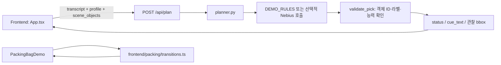
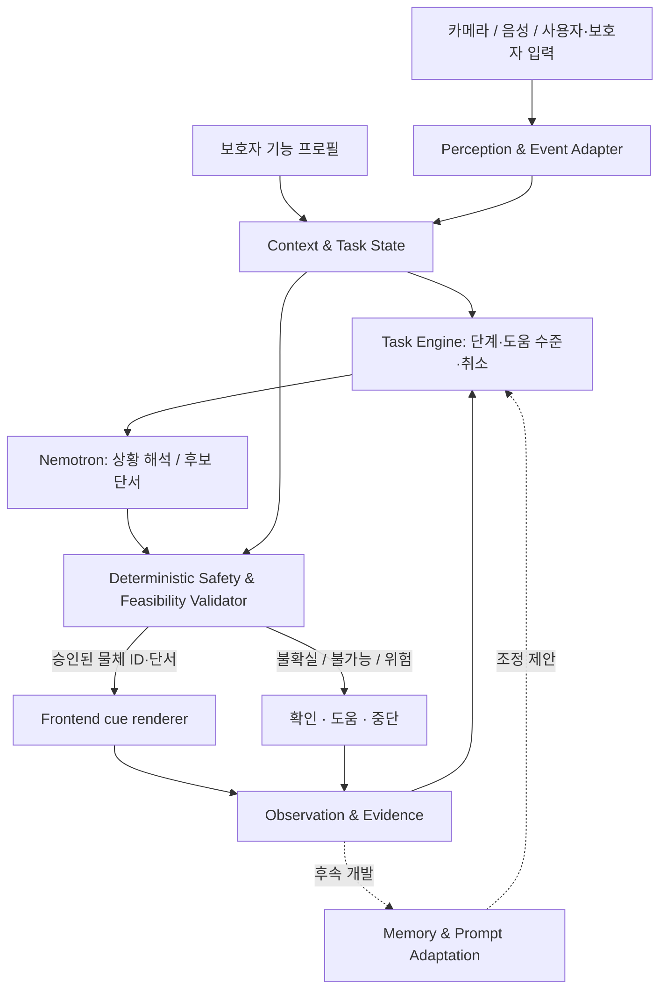

# ContextCue — System Architecture

> **Status:** 설계 기준 + 현재 구현 차이 기록 (2026-10-21, v0.2)
> 제품의 목표와 MVP 우선순위는 [PROJECT_PLAN.md](PROJECT_PLAN.md), 자동문 행동 규칙은 [scenarios/automatic-door.md](scenarios/automatic-door.md)에서 정의한다.

## 1. 책임 분리 원칙

- **Profile-first:** 사람이 입력한 능력·선호 프로필을 사용한다. 모델이 장애 정도나 운동 능력을 자동 진단하지 않는다.
- **Observation-grounded:** 물체 위치는 카메라/검출기 또는 `DEMO_SCENE` fixture에서 오며, LLM이 생성한 좌표는 렌더러에 전달하지 않는다.
- **Deterministic guardrails:** 모델의 계획 제안과 무관하게 수행 가능성과 안전성은 결정적 코드에서 검증한다.
- **One cue at a time:** 다음 행동 하나와 도움 수준을 선택한다. 안내를 제공한 사실을 성공으로 간주하지 않는다.
- **Human-in-the-loop:** 미확인, 불가능, 거부, 위험은 확인/도움/중단으로 전환한다.
- **Reality over aspiration:** 아래 '현재'와 '목표'를 엄격히 구분한다.

## 2. 현재 구현 경로 (2026-10-21 main 기준)



- **Backend:** `backend/app/main.py`는 `GET /api/health`, `POST /api/plan`을 제공한다. `schemas.py`에 Pydantic 계약, `planner.py`에 demo/live 분기 및 유효성 검증이 있다.
- **Frontend:** `frontend/src/App.tsx`가 프로필 A/B와 레거시 API 데모를 관리한다. 프로필은 React 상태이며 새로고침 후 보존되지 않는다.
- **가방 데모:** `frontend/src/packing/`에 5단계 수동 진행·도움 수준 0–4·일시정지/중단/도움 요청 로직이 있다. API/AI/실행 결과 인식과 연결되지 않았다.
- **장면:** 현재 그림과 물체 bbox는 고정 합성 fixture다. `scene_mode=DEMO_SCENE`.
- **Live 경로:** 환경 변수로 Nebius 호출이 가능하도록 작성됐으나 실제 모델 가용성·호출·JSON 결과는 별도 검증이 필요하다.
- **없는 것:** Backend Task Engine, 카메라·검출기/ASR, 음성 출력, 지속 메모리, 실제 행동 성공 감지.

**현 코드와 요구사항의 차이:** 현재 `validate_pick()`는 자동문에서 `can_press_button`만 검사하고 `can_extend_arm`이나 버튼의 도달 가능 거리를 검사하지 않는다. 이를 보완해야 하며 기존 기능을 완성된 신체 검증이라고 부르면 안 된다.

## 3. 목표 구조 — 아직 구현되지 않은 모듈 포함



| 계층 | 책임 | AI/규칙 경계 |
|---|---|---|
| Profile/Context | 승인된 능력, 선호, 과제, 장면의 출처 | 사실 입력; LLM이 능력 확정 금지 |
| Perception Adapter | 실제 물체 ID·라벨·bbox 또는 모의 fixture | 정식 출처 표기; 픽셀 위치 추정 금지 |
| Task Engine | 활성 과제, Least-to-Most, 이벤트 전이, 도움·종료 | 결정적 상태 전이; AI는 후보 제안 |
| Cognitive Planner | 목표·대상 해석과 짧은 단서 제안 | 접근 가능한 Nebius/NVIDIA 모델 검증 필요 |
| Validator | 객체 유효성, 신체 제약, 위험·거부/불확실 확인 | 코드가 최종 승인; 모델이 우회 불가 |
| Cue Renderer | 사용자가 실제 볼/들을 단서 표시 | 검증된 bbox만 강조; 접근성 고려 |
| Evidence/Memory | 수행 여부와 출처·도움 수준 보존 | 완료는 관찰/명시적 확인에서만; 자동 조정은 후속 |

Task Engine이 모델보다 먼저 현재 단계를 정리하고, 모델이 제안한 뒤 최종 Validator가 승인하는 흐름을 권장한다. 세부 호출 순서/상태 저장 방식은 API 설계 시 확정한다.

## 4. 실제 API 계약 — 현재 코드에 구현됨

**POST `/api/plan` 입력 `PlanRequest`**

- `transcript: str` (1–500자): 현재 텍스트 입력이며 ASR 출처는 아니다.
- `user_profile`: `user_id`, `can_grasp`, `can_press_button`, `can_extend_arm` (각 `bool | null`), `preferred_guidance` (선호 방식 목록).
- `scene_objects`: `id`, `label`, 정규화된 `bbox=[left,top,right,bottom]`; 각 좌표는 0–1 범위, ID 중복 금지.

**응답 `PlanResponse`**

- `status`: `cue` / `needs_confirmation` / `needs_assistance` / `unavailable`
- `cue_text`, `object_id`, `bbox`, `reason`
- `mode`: `DEMO_RULES` 또는 `LIVE_NEBIUS`
- `scene_mode`: 현재 `DEMO_SCENE`만 허용.

**중요:** 지금의 `bbox`가 화면에 등장한다고 해서 실제 검출이 이루어진 것은 아니다. `LIVE_NEBIUS`는 언어 모델 호출 모드를 뜻하며 실제 카메라 모드를 뜻하지 않는다. 모의 장면이 아닌 실제 장면을 지원할 때 `scene_mode`의 계약부터 양측에서 함께 변경해야 한다.

**Frontend 미러:** `frontend/src/types.ts`. 타입·필드·status를 변경할 때는 Backend·Frontend·계약 테스트를 같은 변경 단위로 맞춘다.

## 5. 자동문 Task Engine 계약 — 설계안, 미구현

대표 시나리오의 **적은 도움 → 필요한 만큼 도움 증가** 흐름은 [자동문 시나리오](scenarios/automatic-door.md)에 있다. 가방 데모의 도움 수준 0–4와 자동문 문서의 1–4단계는 현재 별개의 프로토타입이다. 번호를 억지로 동일시하지 않고 API 설계에서 매핑을 정의한다.

제안하는 내부 상태:
- `idle` → `goal_detected` → `target_validation` → `cueing` → `awaiting_evidence`
- 분기: `needs_confirmation`, `needs_assistance`, `paused`, `stopped`, `completed`
- 입력 이벤트 후보: `help_requested`, `more_help`, `pause`, `resume`, `stop`, `caregiver_confirmed`, `observation_received`.

이는 **현재의 공개 API status와 다른, 신규 Task Engine용 설계 상태**다. 합의 전까지 공개 계약으로 사용하지 않는다.

### 수행 가능성 판단

- `can_extend_arm=true`와 `can_press_button=true`는 직접 버튼 누르기 안내에 필요한 **기초 조건**이며 실제로 버튼 높이/거리까지 닿는다는 보장은 아니다.
- 하나라도 `false`이면 직접 누르도록 독촉하지 않고 도움·대안을 제안한다.
- 하나라도 `null`이면 정확한 수행 가능성을 확인하지 못한 것이므로 보조자의 확인을 요구한다.
- 버튼이 없거나 여러 개이거나 bbox 출처가 부정확하면 임의로 대상 하나를 택하지 않는다.
- 단순히 응답이 없다는 이유로 실패나 반항으로 간주하거나 무조건 도움 수준을 올리지 않는다.

### 수행 결과의 출처

```text
cue_issued        = 안내 출력됨 (성공 아님)
manual_advance    = 데모 단계가 수동으로 넘어감 (성공 아님)
caregiver_report  = 보조자가 특정 동작 수행을 확인/보고
camera_observation = 검증된 관찰이 특정 동작을 뒷받침
unknown           = 수행 여부 확인 불가
```

버튼을 찾음/눌렀음/문이 열림/통과했음을 별도로 기록한다. 보호자 확인도 카메라 검증과 동일한 증거로 표시하지 않는다. 위 이벤트명은 **데이터 모델 제안**, 구현된 API 필드가 아니다.

## 6. Nebius 및 동작 모드

- 현재 `backend/app/planner.py`는 `AsyncOpenAI`를 사용해 Nebius Token Factory의 OpenAI 호환 엔드포인트에 요청을 보낼 수 있는 구조다.
- `backend/.env`에 비밀 키를 보관하고 Frontend/버전 관리에 노출하지 않는다.
- 기본 모델 ID는 코드의 **초기 후보**다. 현재 계정의 모델 가용성/권한/JSON 안정성/지연을 실호출로 검증해 최종 선택해야 한다.
- 모델은 하나의 기존 관찰 물체 ID만 선택할 수 있다. 유효하지 않은 ID 또는 모호한 대상은 Validator에서 차단한다.
- 호출 실패 시 `DEMO_RULES`로 몰래 대체하지 않고 실패를 명시한다.
- `DEMO_SCENE`(장면의 출처), `DEMO_RULES`(계획의 출처), `LIVE_NEBIUS`(검증된 모델 호출)를 분리해서 표시한다.

## 7. 저장소·책임 경계·테스트

현재 주요 파일:

| 경로 | 설명 |
|---|---|
| `backend/app/main.py` | FastAPI 및 라우팅 |
| `backend/app/schemas.py` | Python API 계약 |
| `backend/app/planner.py` | 단일 단서, demo/live 선택, 검증 |
| `backend/tests/` | API 및 planner 단위 테스트 |
| `frontend/src/App.tsx` | 현재 화면, A/B 프로필, 레거시 API 연결 |
| `frontend/src/packing/` | Backend 비연동 가방 Task 상태 전이 |
| `frontend/src/types.ts` | Python 계약의 TypeScript 미러 |
| `docs/scenarios/automatic-door.md` | 자동문 시나리오 요구사항 |
| `docs/qa/frontend-manual-checklist.md` | 브라우저·접근성 QA 계획(실행 여부 별도) |

데이터베이스, 새 추론 서비스, 카메라 SDK는 확정된 의존성이 아니다. 먼저 순수 상태 전이/단위 테스트를 구현하고 필요가 입증될 때 추가한다.

검증은 `backend/: uv run pytest; uv run ruff check .`, `frontend/: npm run typecheck; npm run build`를 기본으로 한다. CI 성공은 수동 접근성 QA, 실제 행동 인식, Nebius 실호출 성공을 보증하지 않는다.

## 8. 확정할 기술 결정

1. Task Engine 요청/응답 및 세션 식별자의 정확한 계약.
2. 관찰 이벤트에 필요한 타임스탬프·신뢰도·장면 출처·증거 형식.
3. 카메라 bbox와 UI 좌표계의 정합성 및 검출 실패 기준.
4. 실제 보조자 확인 이벤트 UX와 보존 기간.
5. LTM 도움 증가, Prompt Fading 도움 감소를 적용할 충분한 반복 증거의 기준.

**문서 변경 원칙:** 구현이 바뀌면 '현재 구현' 표와 API 계약을 먼저 동기화한다. 검증되지 않은 목표 구조를 현재 동작이라고 쓰지 않는다.
